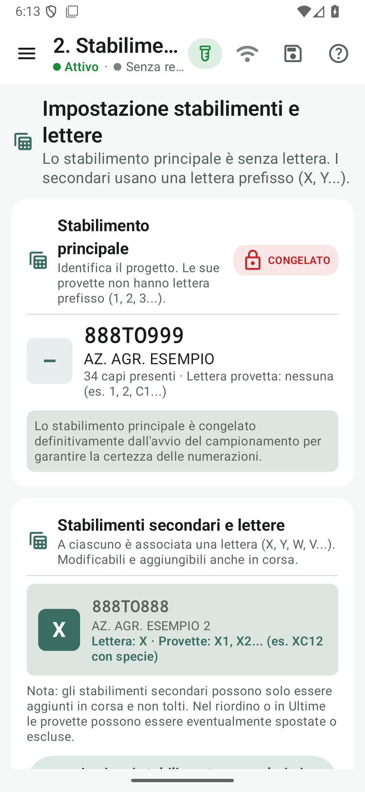
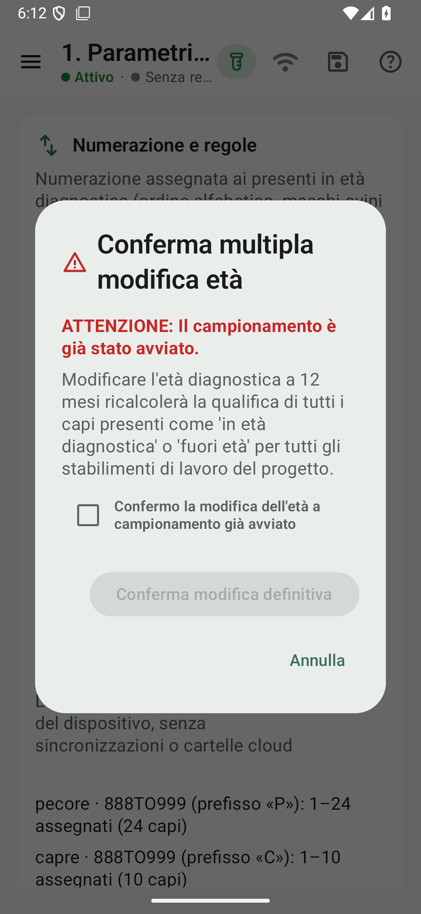
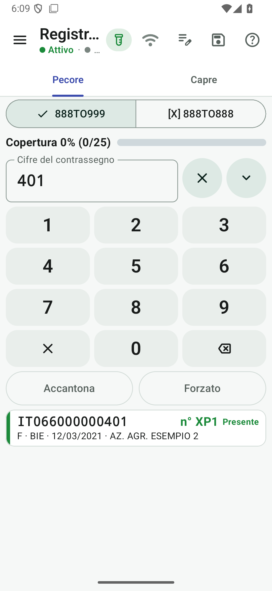
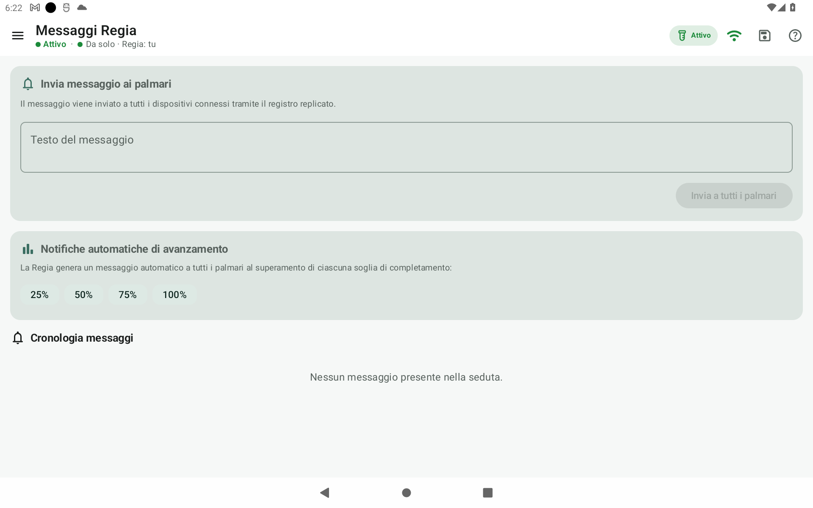
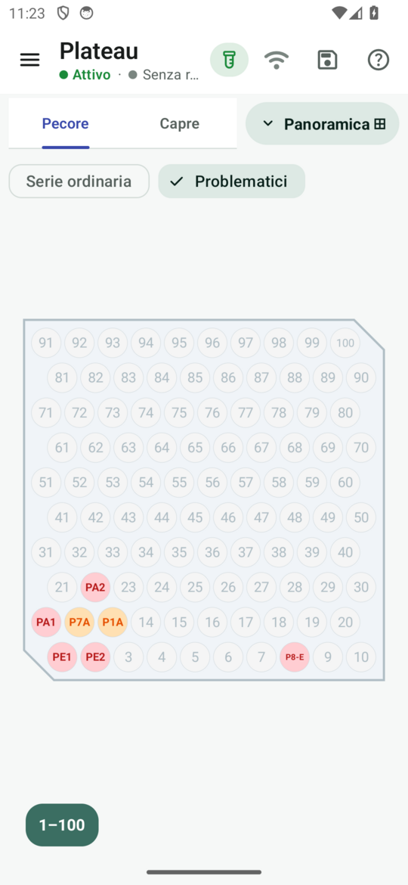
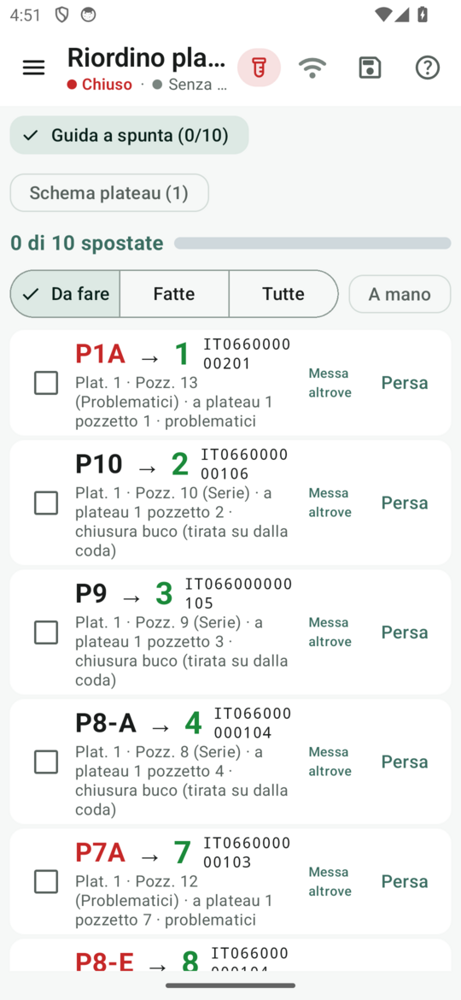
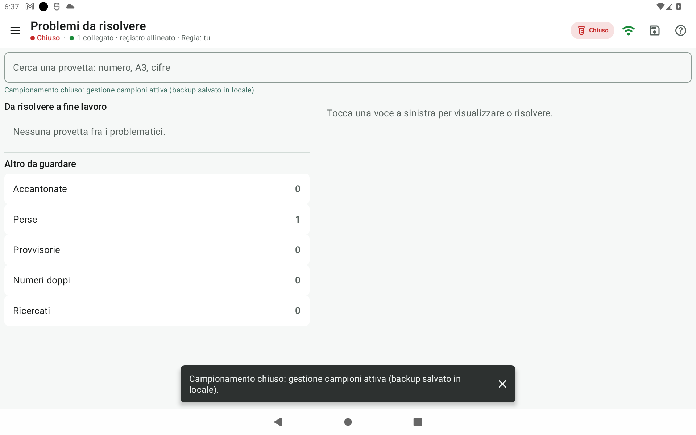

# Le caratteristiche di Fejalog

Un progetto Fejalog raccoglie dati anagrafici BDN, impostazioni di seduta, registro distribuito del lavoro e risultati finali per il laboratorio. La modalità operativa è **Profilassi della brucellosi ovicaprina**.

---

## 1. Multi-stabilimento e stabilimenti secondari in contemporanea

Nelle situazioni di comproprietà, stabilimenti adiacenti o pascolo promiscuo, la profilassi può coinvolgere più stabilimenti contemporaneamente nello stesso intervento:

- **Stabilimento principale congelato**: il primo stabilimento aperto nel progetto è il principale (numerazione naturale `1..N` senza lettera prefisso). All'avvio del campionamento viene congelato nel fold del registro e non può più essere alterato.
- **Stabilimenti secondari aggiungibili in corsa**: la Regia può aggiungere stabilimenti secondari selezionandoli tramite dropdown guidato dai registri BDN caricati. Ciascun secondario mantiene la propria identificazione nelle etichette mostrate dall’app.
- **Serie e invii distinti**: le provette del secondario portano l’identificazione dello stabilimento e generano accettazioni e report separati per ARVET.
- **Spostamento campioni**: se un animale viene campionato per errore con la serie sbagliata, la provetta può essere spostata tra gli stabilimenti con aggiornamento istantaneo dell'attribuzione.

*Quadro di controllo con stabilimento principale congelato e secondo stabilimento in contemporanea.*

---

## 2. Fasi operative vincolanti e sicurezza di processo

Il flusso operativo è governato da tre fasi tassative memorizzate nel registro a eventi crittografico:

1. **`CONFIGURAZIONE`**: la Regia carica i dati BDN, assegna i ruoli e imposta le regole di seduta. I palmari attendono e non possono avviare prelievi.
2. **`CAMPIONAMENTO_APERTO`**: una volta verificata la configurazione di partenza (età diagnostica e lettere di specie), si avviano i prelievi. I parametri strutturali si congelano per prevenire incoerenze sui progressivi.
   - *Modifica età diagnostica in corsa*: se durante il lavoro emerge la necessità di variare la soglia diagnostica (es. 6→12 mesi), la Regia può applicarla solo tramite un dialogo di conferma a due passaggi con **checkbox obbligatoria di sicurezza**. I numeri dei capi già assegnati restano immutabili.
3. **`CAMPIONAMENTO_CHIUSO`**: la Regia chiude il campionamento sul campo. I palmari vengono bloccati e si sblocca la sezione **Gestione campioni** (risoluzione problemi, riordino e fine lavori).

*Dialogo di conferma a due passaggi con checkbox obbligatoria di sicurezza per la variazione dell'età diagnostica.*

---

## 3. Registrazione campioni, ricerca rapida e lavoro offline

- **Ricerca ad alta visibilità**: digitazione delle sole ultime cifre del contrassegno su tastierino a tasti grandi (utilizzabile anche con guanti) o acquisizione immediata tramite lettore Bluetooth in emulazione tastiera (HID). Il **cambio di specie non perde il codice** già digitato o letto col microchip.
- **Tasti e comandi rapidi**: supporto a telecomandi Bluetooth o tastiere (frecce per navigare, frecce destra/sinistra per cambiare specie, barra spaziatrice per le spunte e **Invio/OK per confermare col focus su Conferma**; se il focus è su un’opzione, Invio attiva quell’opzione).
- **Riquadro della scritta sulla provetta**: neutro per campioni ordinari (*scrivi l'etichetta*); blu per ordinari presi da isolato (*non scrivere tutto: solo l'etichetta*); rosso per problematici (*scrivi sempre il contrassegno COMPLETO* oltre al codice mostrato).
- **Tasto «Senza contrassegno»**: funzione di attribuzione rapida per gli animali non identificati rimasti a fine risanamento, filtrando per sesso, razza ed età compatibile dai registri.
- **Codici colore immediati**: verde per capi presenti in età, ocra per capi usciti o doppi, blu per marche disponibili, viola per capi di altri stabilimenti, rosso per codici manuali forzati.
- **Prefissi univoci**: coerenza assoluta nei punti di controllo (anteprima, conferma, etichetta fisica, snackbar, lista ultime e registro durevole).
- **Lavoro continuo in assenza di rete**: se il Wi-Fi o l'hotspot si interrompe, il veterinario continua a lavorare; le provette registrate offline portano l’etichetta da isolato mostrata dal foglio di conferma. Al ripristino della copertura, la convergenza unisce automaticamente i dati.
- **Gestione collisioni simultanee**: in caso di prelievo concorrente dello stesso capo in rete, la convergenza assegna la nota esplicativa e impone a entrambi i veterinari di verificare subito e rinominare la provetta con una nuova etichetta fisica distintiva.

*Ricerca immediata del capo con indicazione chiara del codice stabilimento e della serie.*

---

## Anomalie anagrafiche e di campionamento

Il controllo comprende **smarriti e rubati ritrovati**, morti o macellati che risultano presenti sul campo, venduti e trasferiti, capi di **stabilimenti non campionati**, acquisti con **DDA da verificare**, marche disponibili mai registrate su un capo e contrassegni assenti dai file caricati. Si aggiungono **fuori età diagnostica**, specie discordante, doppi, identificazione attribuita per i senza contrassegno e segnalazioni di orecchini o bolo da sostituire.

La Regia vede anche le provette diventate problematiche dopo un aggiornamento BDN, quelle ora normalizzabili, le perse e ritrovate, le accantonate e le conferme mancate da recuperare. Ogni caso ha un controllo e una soluzione: **non tutti i problematici finiscono nell'invio**; i fuori età sono eliminati per impostazione predefinita. L'app non registra ingressi né corregge i dati nella BDN.

[**Consulta tutte le fattispecie, con azioni in campo ed esiti a fine lavori**](anomalie.md) · [Scegli le prove nel kit](kit.md#quali-anomalie-provare).

---

## 4. Messaggistica Regia e notifiche a soglia di avanzamento

Per coordinare la squadra in stabilimento o al pascolo senza dover urlare tra i recinti o interrompere i prelievi:

- **Comunicazioni di servizio durevoli**: la Regia può inviare messaggi a tutti i palmari o a un singolo veterinario, replicati nel registro con ordinamento Lamport deterministico.
- **Banner a scomparsa e cronologia**: i palmari ricevono il messaggio istantaneamente tramite un banner evidente nella schermata di campionamento, con cronologia consultabile in ora locale.
- **Notifiche automatiche alle soglie**: la Regia configura le percentuali obiettivo (es. 25%, 50%, 75%, 100%). Al raggiungimento di ciascuna soglia, il sistema notifica automaticamente l'avanzamento a tutta la squadra senza generare duplicati.

*Interfaccia della Regia per l'invio di comunicazioni broadcast o selettive e impostazione delle soglie.*

---

## 5. Statistiche, ritmi e classifica della squadra

- **Avanzamento totale e per stabilimento**: quadro sintetico dei capi fatti, attesi, mancanti e percentuale di completamento, con esclusione delle provette perse per prevenire falsi 100%.
- **Statistiche alla persona**: la classifica, le provette fatte e le statistiche seguono la persona fisica (codice fiscale) anche cambiando smartphone a metà seduta; omonimi distinti.
- **Classifica individuale dei veterinari**: medaglie 🥇🥈🥉, provette fatte, ritmo orario, ritmo medio di campionamento e quota problematiche per ciascun veterinario, con badge `Tu` sempre garantito per orientarsi a colpo d'occhio.
- **Stima del tempo di fine**: proiezione dinamica dell'orario di completamento calcolata sull'andamento reale dei prelievi.
- **Permessi differenziati**: la vista Plateau e la funzione di Riordino rimangono riservate alla Regia, mentre i palmari visualizzano solo i dati rilevanti per la propria attività.

*Classifica individuale della squadra con ritmi orari, medaglie e indicatore del veterinario.*

---

## 6. Risoluzione problemi, vista Plateau e riordino

- **Plateau della Regia (riempimento)**: schema a quinconce da 100 pozzetti come il rack vero con verso configurabile (alto→basso default, o basso→alto); a campionamento aperto la Regia **riceve** le provette consegnate e le colloca nei pozzetti indicati. Gli isolati non doppi vanno subito al pozzetto del loro numero; nei progetti nuovi i problematici si alloggiano in una sequenza unica per l’intero progetto in ordine di consegna. I progetti già avviati conservano la disposizione precedente e, senza il parametro del verso, il riempimento basso→alto. Il posto si registra alla consegna e **non cambia più** fino al riordino; ricerca rapida con pozzetto che lampeggia.
- **Riordino solo a campionamento chiuso**: la guida parte dal pozzetto vero di ogni provetta e ne mostra l'etichetta; dalla prima spunta la chiusura è **definitiva**.
- **Mai provette con la stessa scritta**: lettera di specie obbligatoria con due specie, etichette delle annullate mai riusate, avviso bloccante «Controlla subito il capo» e rinomina obbligatoria nelle collisioni fra palmari.
- **Soluzione anomalie guidata**: gestione guidata di capi ritrovati, acquisti con DDA approvata, capi fuori età ed esclusione motivata da ARVET.
- **Compattazione automatica**: chiusura dei buchi sui prenumerati prima dei problematici, raggruppamento specifico dei maschi ovini (*Brucella ovis*) e produzione dello snippet ARVET lineare da `1..n`.

*Immagine di una versione precedente: le righe per veterinario restano nei progetti pregressi. Nei nuovi progetti i problematici seguono la sequenza di consegna.*

*Guida del riordino: etichetta della provetta, pozzetto di partenza e numero finale.*

*Sezione Gestione campioni sbloccata a campionamento chiuso per rifinitura ed export.*

---

## 7. Riconciliazione backup e recupero da emergenza

Se la Regia dovesse esaurire la batteria o guastarsi durante il lavoro:
- I palmari continuano a registrare in memoria locale protetta (`fsync`).
- Ciascun dispositivo può esportare un backup `.zip` crittograficamente verificabile.
- La funzione di **Riconciliazione backup** su un'altra Regia unisce i file superstiti, verifica le catene crittografiche, ricostruisce l'assegnazione iniziale e rigenera tutti i file di export per tutti gli stabilimenti coinvolti.

---

## Approfondimenti

- [**Sotto il cofano: problemi affrontati e architettura**](riferimento/sotto-il-cofano/index.md): come Fejalog risponde ai vincoli del lavoro sul campo per garantire integrità, sincronizzazione e zero perdite di dati.
- [**Tutorial col kit di prova**](tutorial/index.md): prova passo dopo passo con il gregge fittizio 888TO999.
- [**Guida di riferimento completa**](riferimento/index.md): consultazione esaustiva di tutte le schermate e comandi dell'app.
