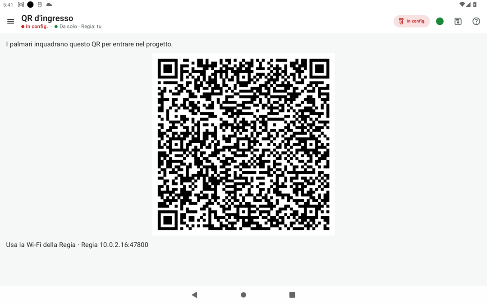

# Rete locale e gestione dei dispositivi

> **A chi serve**: al responsabile della Regia che coordina la connessione Wi-Fi, l'ingresso dei palmari e il monitoraggio della squadra · **Tempo di lettura**: 4 minuti

Fejalog lavora su una rete Wi-Fi locale completamente autonoma, senza connessione internet. I telefoni dei veterinari (palmari) e il tablet del coordinatore (la Regia) si scambiano eventi direttamente. La Regia controlla chi entra, verifica l'allineamento dei registri, vigila sullo stato delle batterie ed può escludere i telefoni spenti quando vede la maggioranza pesata degli attivi.

---

## 1. Cosa serve per la rete

- Il tablet della Regia con il progetto creato e configurato (vedi [Preparare il progetto e avviare la seduta](avvio.md));
- Il router Wi-Fi portatile acceso (oppure l'hotspot Wi-Fi attivato sul tablet della Regia, con nome e password fissi);
- Le **reti del progetto salvate su ogni telefono**: in **Configurazione › 4. Rete del progetto** scegli le reti (router, hotspot del tablet) e, con il tasto **QR**, falle inquadrare con la fotocamera di ogni telefono prima del lavoro;
- I telefoni palmari dei veterinari prelevatori con Fejalog installata;
- Il foglio A4 con il QR Wi-Fi stampato in anticipo (prodotto con lo strumento [Prima del campo](../strumenti/prima-del-campo.md)) oppure il QR visualizzato sullo schermo della Regia.

---

## 2. Cosa si fa: accoglienza e avvio della seduta

### Passo 1: Aprire la rete sulla Regia
All'apertura del progetto, Fejalog chiede se lavorare «In rete» oppure in locale. Scegli **«In rete»** (oppure apri **Configurazione › 4. Rete del progetto**). La pagina Rete della Regia mostrerà:

- Il nome della rete Wi-Fi attiva;
- Il pulsante per visualizzare il **QR d'ingresso** per i palmari (raggiungibile anche dalla voce **Configurazione › QR d'ingresso** o toccando l'icona della rete);
- La tabella dei dispositivi collegati.

*La schermata QR d'ingresso sulla Regia: mostra il QR code per far entrare i palmari della squadra.*

### Passo 2: Far entrare i palmari
I palmari partecipano solo alla fase di campionamento ed entrano a configurazione completata (vedi [Fasi di lavoro e ruoli](../inizia-qui/fasi-e-ruoli.md)). Ogni veterinario prelevatore, con il telefono collegato alla stessa Wi-Fi della squadra:

1. Apre Fejalog e seleziona **Progetto › Entra col QR** (oppure, se già connesso alla rete, tocca «Chiedi di entrare» accanto al progetto rilevato nella voce diretta **Rete**);
2. Sul tablet della Regia compare in sovrimpressione la notifica: **«[Nome Veterinario] chiede di entrare»**;
3. La Regia tocca **«Fai entrare»**. Il palmare scarica istantaneamente il pacchetto anagrafico del progetto e la storia completa del registro a eventi.

### Passo 3: Verificare l'allineamento
Controlla su **Configurazione › 4. Rete del progetto** che i palmari siano allineati alla Regia. L'impronta del pacchetto identifica gli stessi dati iniziali; da sola non prova che siano arrivati tutti gli eventi successivi. Leggi anche gli avvisi di allineamento.

### Passo 4: Avviare il campionamento
Completata la configurazione, la Regia apre **Configurazione › 5. Checklist e avvio** e tocca **«Avvia campionamento»**. I palmari ricevono il nuovo stato con la sincronizzazione.

---

## 3. Gestione dei dispositivi durante il lavoro

### Come leggere lo stato della rete
In cima allo schermo di tutti i dispositivi è presente l'icona di rete, che riassume lo stato del controllo sui doppi prelievi:

- **Verde (Doppi controllati)**: i dispositivi attivi rispondono. Un prelievo già arrivato agli altri viene segnalato; due conferme contemporanee possono comunque richiedere una verifica dopo la sincronizzazione. Segui gli avvisi e controlla le provette fisiche.
- **Giallo (Controllo incompleto)**: qualcuno non risponde. Leggi e copia per intero l'etichetta proposta dall'app per il lavoro da isolato.
- **Rosso (Wi-Fi persa o anomalia)**: leggi il messaggio nella barra e ripristina il collegamento.
- **Grigio (Senza rete)**: dispositivo senza rete.

### Esclusione immediata dei telefoni spenti (Prerogativa della Regia)
Se un veterinario finisce la batteria all'improvviso, danneggia il telefono o si allontana senza mettersi in pausa, il suo dispositivo risulterebbe ancora «attivo» per la rete. Di conseguenza, tutti gli altri colleghi continuerebbero a vedere l'icona gialla e a produrre provette con l'etichetta da isolato.

- **Regola standard dei 2 minuti**: trascorsi 2 minuti senza segnale, il dispositivo silenzioso viene escluso automaticamente se la maggioranza pesata dei nodi attivi è d'accordo.
- **Esclusione a mano immediata**: per gestire il dispositivo non raggiungibile, **solo il responsabile della Regia** può escludere all'istante il telefono spento toccando la riga del dispositivo in **Configurazione › 4. Rete del progetto** (o in **Campionamento › Regia**) e confermando «Escludi adesso».  
  > *Decisione di campo*: l'esclusione a mano è riservata esclusivamente alla Regia (con maggioranza pesata: Regia peso 3, palmare peso 2). I singoli palmari non possono escludere manualmente altri colleghi, garantendo la totale integrità del controllo dei doppi.
- **Pausa e riattivazione dalla Regia**: dalla riga del veterinario nella pagina **Campionamento › Regia**, o da **4. Rete del progetto**, «Pausa» ferma un palmare, collegato o no. Serve che la Regia veda la maggioranza dei device attivi: senza, il tasto è spento e dice perché. A chi non risponde, dillo anche a voce. Il palmare in pausa non registra finché il veterinario non tocca «Riprendi» (da **Campionamento › Pausa e ripresa**) o la Regia non tocca «Riattiva». Se un palmare riattivato non si ricollega, per tutti i doppi tornano non controllati.
- **Rientro del dispositivo**: un palmare escluso (dopo 2 minuti senza risposta, o a mano dalla Regia) **rientra da solo** appena rivede la Regia sulla Wi-Fi: sincronizza gli eventi mancanti e riprende il lavoro. Dopo **«Togli dalla rete»** o **«Escludi definitivamente»** rientra invece solo col QR d'ingresso: la Regia lo apre (in **Campionamento › Gestione dispositivi** oppure in **Rete del progetto**) e il veterinario lo inquadra con **menu › Progetto › Entra col QR**.

### Sorveglianza delle batterie e auto-pausa ordinata
La Regia mostra la batteria comunicata dai palmari e, quando disponibile, una stima dell'autonomia. Sono stime, non una garanzia di durata.

1. **Avvisi al 20% e al 10%**: collega un power bank prima che la carica diventi critica.
2. **Auto-pausa al 5%**: se il telefono non è in carica, l'app si mette in pausa e prova a comunicarlo agli altri. La Regia può modificare le soglie nella pagina **Campionamento › Messaggi**.
3. Se il telefono si spegne prima di comunicare la pausa, gestiscilo come dispositivo non raggiungibile. Non presumere che gli altri siano già tornati in verde.

---

## 4. Cosa può andare storto

| Sintomo | Causa probabile | Soluzione operativa |
|---|---|---|
| **Il palmare inquadra il QR ma non si connette** | Il telefono non è sulla Wi-Fi della Regia (rete non salvata, o una frequenza che il telefono non vede: alcuni telefoni vedono solo i 2,4 GHz). | La guida dice quale Wi-Fi toccare e ha il tasto per aprire il pannello di Android: tocca la rete; se non c'è, salvala col suo QR Wi-Fi (o con «Salva la rete in Android»). Fejalog entra da solo appena la Regia risponde. |
| **Impronta diversa tra palmare e Regia** | Il palmare ha caricato un pacchetto BDN obsoleto o una versione non allineata. | Fai uscire il palmare dal progetto (**menu › Esci dal progetto**); dalla Regia apri **Configurazione › QR d'ingresso**, fai rientrare il palmare scansionando nuovamente il QR per ricevere la copia aggiornata. |
| **Tutti i palmari diventano improvvisamente gialli** | Il tablet della Regia o il router Wi-Fi ha subito un calo di segnale o si è spento. | Verifica l'alimentazione del router o del tablet. Se il router è caduto, accendi l'hotspot del tablet: i telefoni che l'hanno salvato ci passano da soli e Fejalog ritrova la squadra (il tablet è il loro gateway). Se serve, in **Rete del progetto** tocca **«Passa tutti qui»**: i palmari aprono il pannello Wi-Fi. Ultima risorsa, il QR della Regia. |
| **Un palmare rientrato mostra numeri non sincronizzati** | Ritardo temporaneo nel passaggio dei pacchetti Wi-Fi. | Mantieni il telefono a portata del router per 10–15 secondi: la sincronizzazione è incrementale e si riallinea automaticamente al primo scambio dati. |

---

## Pagine collegate

- [Fasi di lavoro e ruoli](../inizia-qui/fasi-e-ruoli.md)
- [Requisiti hardware e software per la Regia](requisiti.md)
- [Preparare il progetto e avviare la seduta](avvio.md)
- [Consegne delle provette e gestione dei plateau](consegne-plateau.md)
- [Cosa succede se… (per i prelevatori)](../chi-preleva/cosa-succede-se.md)
