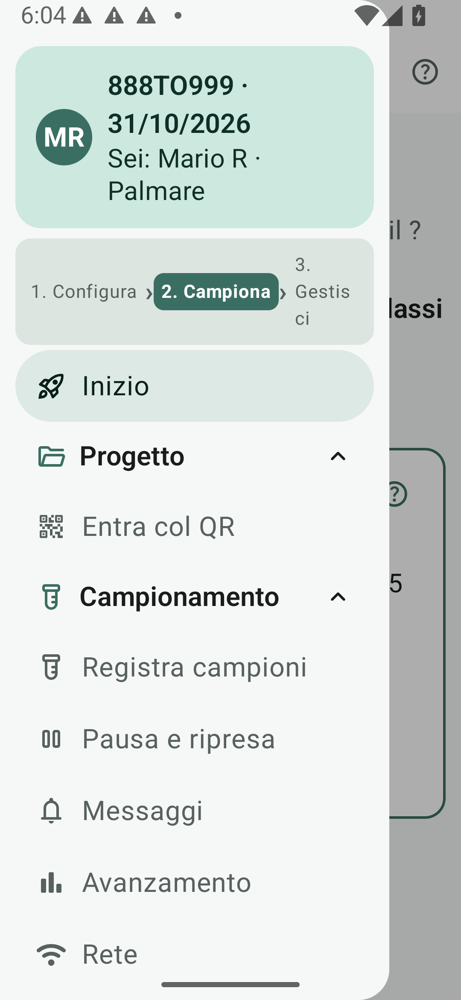

# In campo: scheda pratica per il veterinario

> **A chi serve**: chi preleva con il palmare · **Tempo di lettura**: 3 minuti

Stampa questa pagina con **Stampa** nel browser. Per il materiale: [scheda del veterinario](../checklist-veterinari.md).

## 1. Entra nella seduta

Configura prima il tuo nome in **Impostazioni › Utente**. Collegati alla Wi-Fi del progetto: il QR Wi-Fi cartaceo collega alla rete; il QR di ingresso sullo schermo della Regia apre la seduta tramite **Progetto › Entra col QR**. In alternativa, dalla voce diretta **Rete** chiedi di entrare e attendi l'accettazione. Verifica allineamento e campionamento aperto.

*Menu del palmare: Progetto (Entra col QR), Campionamento con Pausa e ripresa, e Rete.*

## 2. Cerca e controlla il capo

Leggi il microchip col lettore Bluetooth configurato come tastiera, oppure digita le ultime cifre sul tastierino. I risultati mostrano prima «finisce con», poi «contiene». Controlla il contrassegno completo e scegli il capo; Invio dopo una lettura lo sceglie se è unico.

**Cambio specie**: schede, swipe e frecce destra/sinistra conservano il codice. Se la conferma è aperta, si chiude e ricerca nell'altra specie; si riapre solo con un unico capo compatibile.

## 3. Scrivi e conferma

Controlla il riquadro della scritta, distinto dalla banda colorata del capo:

| Riquadro | Che cosa scrivere sulla provetta |
|---|---|
| **Neutro**, ordinario con controllo completo | Solo l'etichetta mostrata. |
| **Blu**, ordinario senza tutti collegati | Solo l'etichetta mostrata, completa del suffisso. Non scrivere tutto. |
| **Rosso**, fuori registro | Tutta la scritta mostrata, con il **contrassegno COMPLETO**. |

Controlla orecchini DX/SX, bolo e note. Puoi toccare **Foto** per acquisire fino a 5 immagini del capo o della provetta (trasmesse in rete alla Regia). Premi **Conferma** e attendi l'esito verde **Registrata**. Un esito rosso non conferma il salvataggio: leggi il motivo e verifica nelle **Ultime** prima di riprovare.

## Tasti nel foglio di conferma

- **Destra/sinistra**: cambiano specie conservando il codice.
- **Su/giù**: spostano il focus tra i controlli; **spazio** attiva l'opzione evidenziata.
- **OK/Invio**: conferma col focus iniziale su **Conferma**; se lo sposti, attiva l'opzione in focus. Torna su Conferma per salvare.
- **Esc/Indietro**: chiudono senza confermare. Nei campi di testo spazio e Invio restano testo.

I telecomandi Bluetooth da dito (BLE-M3) sono supportati nativamente (frecce, OK centrale, Indietro); provali in **Impostazioni › Dispositivo › Prova del telecomando**.

## Senza contrassegno

A campionamento aperto, tocca **Senza contrassegno**. Indica sesso, razza ed età compatibile dai registri; DX e SX sono segnati da sostituire. Se dopo compare il capo con le marche, avvisa la Regia; caso previsto, non ancora provato sul campo.

## Consegna e imprevisti

Porta le provette alla Regia, che registra **Ricevi (N)** e le posa seguendo il Plateau. Non cambiare le scritte da solo. Se la Wi-Fi cade, tocca **Ricollegati** e segui la banda; puoi continuare se il campionamento è abilitato, ma i doppi non sono controllati in diretta. Se ti allontani dalla rete, mettiti in pausa da **Campionamento › Pausa e ripresa**: altrimenti tutti passano alla gestione provvisoria, con i doppi non controllati. La Regia può comunque metterti in pausa. Se la Regia mette in pausa il tuo palmare, la registrazione viene sospesa fino a quando non premi **Riprendi** (raggiungibile solo da **Campionamento › Pausa e ripresa**) o vieni riattivato dalla Regia. Prima di uscire attendi l'allineamento e usa **menu › Esci dal progetto** o **menu › Esci dall'app**.

[Fasi di lavoro e ruoli](../inizia-qui/fasi-e-ruoli.md) · [Imprevisti e conferme mancate](cosa-succede-se.md) · [Domande](domande.md) · [Guarda i micro-video operativi](../inizia-qui/video.md#2-micro-video-operativi)

