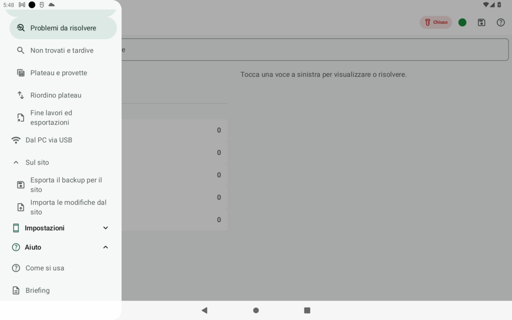

# Controllo provette, problemi e statistiche

> **A chi serve**: al veterinario responsabile che controlla la quadratura della seduta, tratta le anomalie, recupera i mancanti e guida il riordino dei plateau · **Tempo di lettura**: 5 minuti

Dopo aver caricato il backup nello strumento [Fine lavori sul computer](../strumenti/fine-lavori.md), la schermata mette a disposizione un ambiente di lavoro avanzato suddiviso in schede specializzate. Da qui puoi esaminare ogni singolo prelievo, risolvere le eccezioni anagrafiche, identificare provette con etichette danneggiate e seguire la guida al riposizionamento nei plateau.

*Il menu di Gestione campioni sulla Regia a campionamento chiuso: le sezioni Sul tablet, Dal PC via USB e Sul sito.*

---

## 1. Scheda «Provette»: verifica di dettaglio e modifiche

La scheda **Provette** presenta l'elenco tabellare di tutti i campioni registrati durante la profilassi:

- **Filtri di visualizzazione rapidi**: filtra istantaneamente per specie (pecore o capre), stabilimento di lavoro, categoria del campione (ordinarie, fuori registro, doppi, collisioni, annullate, perse).
- **Tasto rapido «Copia»**: presente accanto a ogni codice contrassegno per incollarlo al volo in BDN o su altre banche dati.
- **Dettaglio completo del prelievo**: aprendo la scheda di una provetta si visualizza l'intera cronologia dell'evento:
  - Chi ha eseguito il prelievo (nome del veterinario);
  - Timestamp esatto di registrazione;
  - Modalità di identificazione: *certo* (tramite lettore microchip Bluetooth o contrassegno intero digitato) oppure *meno certo* (selezionato dall'elenco a partire da poche cifre digitate);
  - Storia delle modifiche registrate sul campione.
- **Modifiche consentite dalla Regia**:
  - Aggiunta di note descrittive sul capo;
  - Segnalazione di orecchino sinistro (SX), destro (DX) o bolo da sostituire;
  - Rettifica del sesso (se errato in BDN);
  - **Rinomina dell'etichetta**: l'app vieta categoricamente l'inserimento di etichette omonime già esistenti nel registro;
  - **Annullo del campione**: motivato; l'etichetta annullata viene ritirata definitivamente e non verrà mai riemessa.

---

## 2. Scheda «Problemi da risolvere»: gestione delle eccezioni

La scheda raggruppa automaticamente tutte le situazioni critiche rilevate sul campo:

- **Capi fuori registro**: animali con marche non presenti in BDN, capi usciti per morte o macellazione, capi appartenenti ad altri stabilimenti;
- **Verifica DDA (Documento di Accompagnamento)**: per capi acquistati da altri stabilimenti con DDA dichiarato in campo, la Regia verifica e registra se il DDA è valido prima di normalizzare il campione;
- **Doppi prelievi confermati**: campioni prelevati due volte per errore o necessità diagnostica.

### Gestione dei fuori registro e soluzioni ammesse
Per ogni tipologia di fuori registro, Fejalog vieta l'eliminazione sistematica dei campioni di sangue: ogni provetta prelevata va preservata e inserita negli invii. Le opzioni disponibili sono:

- **In coda, ARVET a mano**: il motore assegna i numeri finali in coda; leggi il riepilogo degli inserimenti automatici e di quelli da completare a mano in ARVET.
- **Normalizzata**, quando disponibile (es. capi verificati col DDA o confermati in anagrafe): il campione viene trattato regolarmente.
- **Fuori età**: la Regia decide a fine lavori in Gestione campioni se metterli in coda («In coda») o scartarli («Eliminate»); fino alla scelta restano «da decidere» e contano temporaneamente come in coda.
- **Scarto di singole provette**: l'eliminazione non è mai applicabile a un'intera tipologia, ma è riservata esclusivamente a singoli campioni fisicamente deteriorati, rovesciati o rotti.

Nella scheda **Avvisi** esamina anche doppi scoperti, capi ricercati, collisioni, controlli incompleti e dispositivi mai rientrati. «Visto» prepara una presa visione da riportare nell'app.

---

## 3. Scheda «Non trovati e registrazione tardiva»: il confronto `5?`

Quando il campionamento è chiuso, la scheda presenta la distinta completa di tutti i capi in età diagnostica che non sono stati presentati o prelevati:

### L'algoritmo di confronto per somiglianza
Se sul tavolo della Regia è rimasta una provetta fisica con la scritta a pennarello sbiadita, parzialmente cancellata o macchiata:

1. Inserisci nel campo di ricerca ciò che riesci a decifrare; puoi usare il carattere jolly `?` per indicare una cifra illeggibile (ad esempio digitando `5?` o `IT00100?42`);
2. L'algoritmo confronta i caratteri inseriti con la distinta dei capi non prelevati;
3. Il sistema ordina i candidati per somiglianza, specificando chiaramente il motivo di corrispondenza (es. *«Coincidono 5 cifre finali, sesso femmina compatibile»*).

### Registrazione tardiva dalla Regia
Individuato il capo corrispondente:

- La Regia tocca **«Attribuisci»**: scrive l'etichetta presente sul corpo della provetta e inserisce una breve nota sulle modalità di riconoscimento;
- Il sito prepara un’azione: diventa un evento solo dopo esportazione e importazione confermata sulla Regia;
- **Il campionamento non viene riaperto**: la registrazione tardiva è una facoltà esclusiva della Regia a campionamento chiuso che non richiede il rientro dei palmari.

---

## 4. Scheda «Riordino dei plateau»: la guida al riposizionamento

A campionamento chiuso, apri la scheda **Riordino**: la pagina calcola la sistemazione dalle azioni correnti e genera la guida passo per passo per trasformare la disposizione fisica provvisoria dei plateau nei lotti definitivi ordinati per ARVET:

1. **Opzione «Chiudi i buchi»**: se attivata, il motore ricompatta la numerazione finale eliminando i vuoti lasciati da provette perse, annullate o eliminate, assegnando numeri strettamente consecutivi. Va selezionata prima del primo invio applicato.
2. **Guida con invio singolo e selezione**: ogni riga mostra etichetta, partenza fisica, destinazione suggerita e fattispecie. Il campo **A** si può modificare e **Ripristina** riporta il suggerimento. Se il numero è occupato, lo scambio richiede conferma. **Invia** (o **Applica** sul sito da backup) applica una sola riga. Le caselle servono per il batch al numero suggerito; le righe modificate si inviano singolarmente. Il contatore delle fatte viene dalle azioni applicate.

3. **Regola di chiusura irreversibile**:
   > [!IMPORTANT]
   > Il primo evento di gestione dopo la chiusura, anche una nota o una registrazione tardiva, rende definitiva la chiusura. Dal backup le azioni diventano eventi quando la Regia le importa; via USB, dopo l’accettazione della sessione sul tablet, ogni invio valido scrive subito un evento: da quel momento il campionamento non si riapre più.

---

## 5. Scheda «Statistiche»: quadratura e rendimento per persona

La scheda fornisce il consuntivo della seduta di profilassi:

- **Quadratura contabile**: capi presenti in BDN, campionati ordinari, campionati fuori registro, capi non trovati, percentuale di copertura per specie e stabilimento.
- **Riepilogo anomalie**: conteggio provette senza transponder (orecchino DX o bolo mancante), doppi scoperti, capi ricercati individuati.
- **Classifica e andamento orario legati alla persona fisica**:
  - Le metriche di produttività (numero di prelievi, velocità oraria) sono calcolate sul **codice fiscale** della persona fisica;
  - Se un veterinario ha cambiato telefono durante la seduta o ha utilizzato un palmare sostitutivo, il rendimento somma automaticamente tutti i dispositivi usati dalla stessa persona.
- **Produttività della gestione**: accanto ai grafici del campionamento, mostra l'andamento aggregato delle operazioni di risanamento nel tempo (senza classifiche individuali): azioni eseguite, plateau completati/da completare/da svuotare, fuori registro ricollocati o scartati e stima della fine.
- **Riepilogo fuori registro e tardive**: quadro delle anomalie gestite diviso per fattispecie ed esito finale, con il conteggio distinto di registrazioni tardive e modifiche ai campioni (disponibile a schermo, nel CSV per l'ufficio, nello zip e nel foglio «gestione_progetto» dell'Excel).

---

## 6. Gestione visiva dal Plateau

La vista Plateau a campionamento chiuso permette di intervenire direttamente sui pozzetti:

- **Bordi colorati di stato**:
  - **Verde**: plateau completo (tutti i 100 pozzetti occupati; l'ultimo plateau diventa verde quando non vi sono buchi e non restano fuori registro da ricollocare);
  - **Giallo**: plateau da completare;
  - **Rosso**: plateau dei fuori registro da svuotare (diventa verde solo quando è completamente vuoto).
- **Azioni dirette sulla provetta**: toccando una provetta si può copiarne il contrassegno, riattribuire un altro capo (cercato in anagrafe o digitato per intero), spostarla a un'altra posizione (con proposta di scambio se occupata), registrarne lo smarrimento o lo scarto con motivo.
- **Scarto recuperabile**: una provetta scartata è esclusa da ARVET e non tiene rosso il plateau dei fuori registro né blocca il completamento, ma resta recuperabile in qualunque momento con «Annulla scarto». Una provetta persa torna con «Ritrovata».
- **Conferme**: scarto e smarrimento chiedono un motivo; un capo già prelevato si conferma come doppio; per un capo senza anagrafe servono sesso, razza e data di nascita; uno spostamento che tocca un plateau completo chiede una conferma esplicita.
- I bordi riportano anche il testo (completo, da completare, da svuotare), non solo il colore.

---

## 7. Cosa può andare storto

| Problema | Causa probabile | Soluzione operativa |
|---|---|---|
| **Una provetta fisica non compare nell'elenco** | Prelievo non confermato sul palmare prima della chiusura. | Usa la scheda *Non trovati e tardive › Attribuisci* (negli strumenti del sito o in **Gestione campioni › Sul tablet › Non trovati e tardive** sull'app) per registrarla come tardiva con l'etichetta fisica presente sulla provetta. |
| **Nella guida al riordino una provetta non è dove dice l'app** | Errore manuale di posa avvenuto in campo durante le consegne concitate. | Controlla etichetta e campione fisico. La ricerca indica il posto registrato, non rileva dove si trova materialmente la provetta. Per movimenti o scambi usa i comandi della scheda Riordino e verifica che siano accettati. |
| **Un capo senza transponder non è evidenziato** | Il prelevatore ha dimenticato di spuntare la casella DX/Bolo nel foglio di conferma. | Apri la scheda della provetta in *Provette*, attiva la spunta «DX da sostituire» o «Bolo da sostituire» e salva la modifica. |

---

## Pagine collegate

- [Panoramica: gli strumenti dopo il campo](../strumenti/index.md)
- [Riconciliazione e verifica dei backup](riconcilia-backup.md)
- [Il modello 2/33 finale con numeri definitivi](modello-233-finale.md)
- [Gli snippet per ARVET](snippet-arvet.md)
