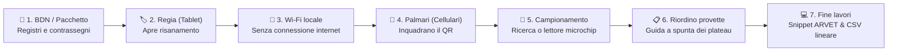
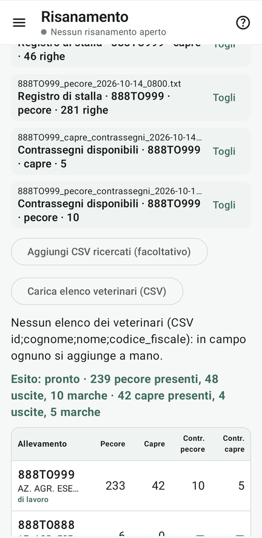
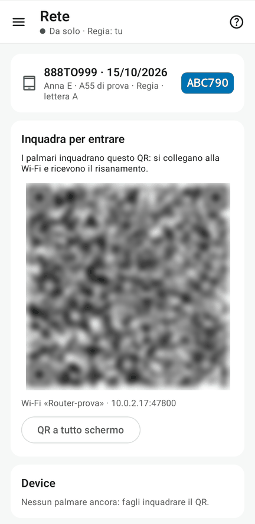
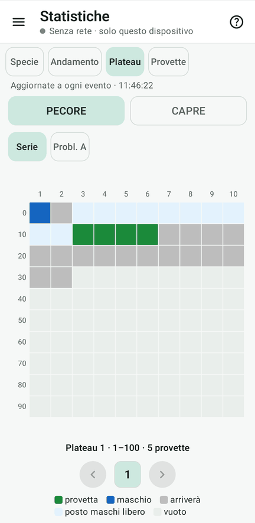

# Fejalog

Fejalog è un'app Android per registrare **in campo** le provette della **profilassi della brucellosi ovicaprina**. Ci
lavorano insieme più device:

- **un tablet, la Regia**;
- **i telefoni dei veterinari, i palmari**.

Comunicano su una Wi-Fi locale, **anche senza internet**. L'app accompagna il lavoro fino agli **snippet per ARVET**
dei tre invii: pecore, capre e maschi *Brucella ovis*.

- **Provare subito**

    ---

    Il [tutorial col kit di prova](tutorial/index.md): un gregge inventato di 359 capi, da «prelevare» con le schede
    stampate, dal primo device fino ad ARVET.

- **Scaricare**

    ---

    L'[APK firmato](scarica.md), il kit di prova e le schede da stampare.

- **Usare in campo**

    ---

    Il [foglio per gli operatori](operatori.md) e la [guida di riferimento](riferimento/index.md), gli stessi testi
    dell'app.

- **Registrare in ARVET**

    ---

    Come funzionano gli [snippet](arvet.md), anche per i capi che non sono nell'elenco del campionamento.

## Come funziona in sintesi

## Come muoversi nell'app

### I palmari: prelievo rapido sul campo

<figure markdown="span">
  
  <figcaption>1. Ricerca con le ultime cifre sul tastierino a tasti grossi (o lettore Bluetooth)</figcaption>
</figure>

<figure markdown="span">
  
  <figcaption>2. Foglio di conferma con numero grande assegnato e stato transponder</figcaption>
</figure>

<figure markdown="span">
  
  <figcaption>3. Elenco ultime: modifica, persa, filtro annullate e salvataggio garantito</figcaption>
</figure>

### La Regia: coordinamento della seduta

<figure markdown="span">
  
  <figcaption>Apertura: caricamento registri BDN e assegnazione immediata dei numeri 1..N</figcaption>
</figure>

<figure markdown="span">
  
  <figcaption>Rete: QR code per collegare istantaneamente i palmari senza password a mano</figcaption>
</figure>

<figure markdown="span">
  
  <figcaption>Monitoraggio: schema visivo dei plateau di provette e statistiche di prelievo</figcaption>
</figure>

<figure markdown="span">
  
  <figcaption>Riordino: guida a spunta passo-passo per la sistemazione finale delle provette</figcaption>
</figure>

## Che cosa fa

- **Catalogazione provette e accettazione al laboratorio.** Registra con precisione assoluta le provette di sangue
  prelevate in campo. Per il Piemonte prepara gli **snippet per ARVET** per i 3 invii (pecore, capre, maschi *Brucella ovis*);
  per l'uso fuori dal Piemonte genera per ogni invio un file **CSV lineare** nel formato `provetta,contrassegno`.
- **Numeri definitivi senza doppioni.** Ogni device prenota in anticipo i suoi numeri: due provette con lo stesso
  numero non esistono mai, e un numero mostrato non cambia più. Si lavora anche se la Regia si spegne.
- **Il capo giusto.** Si cerca con le ultime cifre del contrassegno sul tastierino a tasti grossi, oppure col lettore
  di microchip Bluetooth (es. Allflex AWR250 configurato in modalità tastiera HID). Il foglio di conferma dice se il capo
  è uscito, di un altro stabilimento, ricercato o già prelevato da un collega (**doppio contrassegno**, controllato in tempo reale).
  Per i capi problematici o non prenumerati, si raccomanda di scrivere sulla provetta anche il contrassegno.
- **Niente si perde e salvataggio protetto.** Ogni evento è salvato sul device prima di mostrare ✓ ed è replicato su tutti gli altri, e
  nessuna correzione cancella la storia. Il salvataggio del backup e delle uscite è ristretto a cartelle locali e provider
  cloud autorizzati (Google Drive, OneDrive, Dropbox, Nextcloud), escludendo categoricamente app di posta (Gmail) o app di intelligenza artificiale.
- **A fine lavoro.** Fejalog calcola la sistemazione dei plateau e dà una guida a spunta per spostare le provette. Poi
  prepara gli snippet ARVET, i file CSV per altri gestionali, le cose da fare per l'allevatore, i report e le anomalie.
- **I file della BDN.** I registri di stalla e i contrassegni disponibili si caricano direttamente sul tablet, anche a
  lavoro in corso (per esempio un acquisto con DDA).

## Che cosa serve

| | |
|---|---|
| Regia | un tablet Android **11 o più recente**, in orizzontale |
| Palmari | telefoni Android **11 o più recenti** (uno per veterinario) |
| Rete | una Wi-Fi comune anche **senza internet**: router da viaggio, Wi-Fi dell'allevamento o hotspot del tablet |
| Facoltativo | un lettore di microchip Bluetooth che scrive come una tastiera |
| ARVET | un PC con Chrome o Edge, per incollare gli snippet nella console |

!!! info "I dati restano sui device"
    Fejalog non manda niente su internet e non raccoglie statistiche d'uso. I dati del risanamento passano solo fra i
    device sulla Wi-Fi locale, e i backup vanno dove li salva chi li fa.

!!! warning "Esempi inventati"
    Tutti gli esempi di questo sito e del kit di prova sono **inventati**: stabilimento 888TO999 «AZ. AGR. ESEMPIO»,
    contrassegni IT066000000NNN. Non scrivere mai in una segnalazione pubblica dati veri (contrassegni, codici
    fiscali, codici di stabilimenti).
