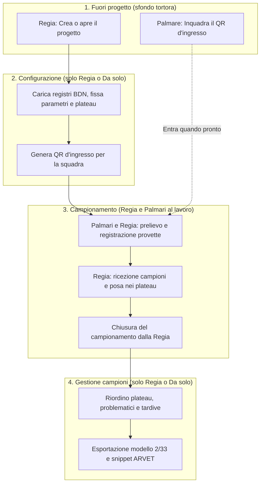

# Fasi di lavoro e ruoli

> **A chi serve**: a tutta la squadra (veterinari prelevatori e responsabile della Regia) · **Tempo di lettura**: 4 minuti

Fejalog organizza la registrazione delle provette in campo separando in modo netto i **momenti della giornata** (le fasi) e i **compiti delle persone** (i ruoli). L'interfaccia dell'app si adatta a questa distinzione: ogni operatore vede e può utilizzare esclusivamente i dati, i moduli e i comandi pertinenti alla fase in corso e al ruolo assegnato al dispositivo.

---

## 1. Il principio guida: solo ciò che serve alla fase e al ruolo

Niente distrazioni e niente rischi operativi:
- Chi è nei recinti o nella corsia di prelievo deve potersi concentrare sull'animale, sul microchip, sull'etichetta corretta della provetta e sull'avanzamento, senza il timore di toccare parametri di configurazione o impostazioni di seduta.
- Chi coordina al tavolo della Regia deve avere a disposizione il quadro completo della squadra, l'accoglienza delle provette, il riempimento guidato dei plateau e la sorveglianza della rete locale.

Questo principio si riflette sia nei menu dell'app sia nei **colori di lavoro** della barra e dei fondi, che permettono di riconoscere a colpo d'occhio come sta operando il dispositivo:

| Ruolo / Stato | Colore di lavoro | Chi lo usa | Funzione principale |
|---|---|---|---|
| **Palmare** | **Verde salvia** | Veterinario prelevatore | Campiona nei recinti, controlla avanzamento e classifica, gestisce la propria connessione. |
| **Regia** | **Blu pastello** | Responsabile al tavolo | Configura il progetto, riceve provette, guida i plateau, vigila sulla rete, chiude la seduta e gestisce i campioni. |
| **Da solo** | **Rosa antico** | Veterinario singolo | Esegue tutte le fasi da un unico dispositivo, senza rete di squadra. |
| **Fuori progetto** | **Tortora** | Stato iniziale neutro | Schermata iniziale prima di aprire, creare o raggiungere una seduta. |

---

## 2. Le fasi di lavoro

Una giornata di profilassi si articola in quattro momenti successivi: una fase preliminare fuori progetto e tre fasi all'interno del progetto.

### Fase 0: Fuori progetto
È lo stato iniziale in cui si trova l'app all'avvio. Non vi è ancora alcuna seduta attiva:
- **Cosa fa la Regia**: tocca **Nuovo progetto** per iniziare una nuova profilassi, oppure **Apri progetto** / **Recenti** per riprendere un progetto già preparato in ufficio.
- **Cosa fa il palmare**: tocca **Entra col QR** per inquadrare il codice mostrato dalla Regia (o cerca la seduta nella voce diretta **Rete** toccando «Chiedi di entrare»).
- **Cosa fa chi è Da solo**: crea o apre il proprio progetto locale.

---

### Fase 1: Configurazione (solo Regia)
La fase di configurazione trasforma i file ufficiali BDN nel piano di lavoro della giornata. È riservata alla Regia (o a chi lavora da solo):
- Si caricano i registri BDN degli stabilimenti (pecore, capre, contrassegni disponibili);
- Si imposta l'età diagnostica minima (es. 6 o 12 mesi);
- Se sono presenti sia pecore sia capre, si assegna obbligatoriamente la lettera di specie (regola di sicurezza);
- Si fissa il verso di riempimento dei plateau fisici (dall'alto verso il basso o dal basso verso l'alto);
- Si definiscono gli stabilimenti di lavoro (principale e secondari);
- Si impostano la rete Wi-Fi di seduta e l'eventuale rete di riserva.

!!! important "I palmari entrano solo a configurazione completa"
    I veterinari prelevatori non possono accedere al progetto mentre la Regia sta ancora configurando i registri e le regole. La Regia genera il QR d'ingresso e accoglie i palmari nella rete **soltanto a configurazione completata**, garantendo che tutta la squadra inizi a lavorare con gli stessi parametri coerenti e congelati.

---

### Fase 2: Campionamento (Regia e Palmari)
È la fase operativa vera e propria nei recinti e al tavolo:
- **I palmari**: leggono i microchip col lettore Bluetooth o digitano le ultime cifre sul tastierino; visualizzano il capo anagrafico con i codici colore; leggono il riquadro dell'etichetta per sapere cosa scrivere sulla provetta (neutro per ordinaria, blu per isolato, rosso con contrassegno completo per problematico); possono scattare foto al campione se occorre; confermano il prelievo; consultano le proprie ultime provette per annotazioni; portano i campioni al tavolo.
- **La Regia**: accoglie i lotti di provette consegnate toccando **Ricevi (N)**; segue lo schema visualizzato a video (**«Metti qui»**) per collocare fisicamente ciascuna provetta nel pozzetto esatto del plateau; vigila sulla rete locale e sul livello di batteria dei palmari; gestisce pause o esclusioni se un dispositivo si spegne; può registrare provette direttamente se necessario.
- **Chiusura della fase**: quando tutti gli animali sono stati prelevati e la squadra lascia il gregge, **solo la Regia** chiude il campionamento. L'operazione richiede un dialogo di sicurezza che segnala chi è ancora al lavoro, le provette non ancora consegnate e una parola di conferma da digitare.

---

### Fase 3: Gestione dei campioni (solo Regia, dopo la chiusura)
Terminato il campionamento sul campo, si apre la gestione dei campioni (in ufficio o sul furgone). I palmari hanno terminato il loro compito ed escono dal progetto; la fase è gestita interamente dalla Regia (anche collegando il tablet a un PC Windows via USB, senza internet) o da chi lavora da solo:
- **Riordino dei plateau**: chiusura dei buchi rimasti liberi nelle serie ordinarie spostando le provette dai numeri alti o ricollocando i capi problematici normalizzati;
- **Plateau dei problematici**: verifica di tutti i campioni anomali e svuotamento progressivo del plateau problematici verso le destinazioni corrette;
- **Provette tardive e modifiche**: inserimento di provette fisiche scritte ma non confermate in campo, rettifiche di contrassegni, gestione di scarti (recuperabili) e smarrimenti;
- **Fine lavori**: calcolo dei numeri definitivi di provetta, generazione del report del modello 2/33 e produzione degli **snippet per ARVET** per i 3 invii (pecore, capre, maschi *Brucella ovis*).

!!! warning "Chiusura definitiva al primo evento di gestione"
    La chiusura del campionamento può essere annullata per riprendere i prelievi solo fino a quando non viene registrata alcuna azione di gestione. Dal primo evento di gestione campioni (anche una nota, una tardiva o uno spostamento), la chiusura diventa irreversibile.

---

## 3. Matrice Fase × Ruolo

La tabella riassume con precisione cosa è accessibile a ciascun ruolo nelle diverse fasi:

| Fase | Regia (blu pastello) | Palmare (verde salvia) | Da solo (rosa antico) |
|---|---|---|---|
| **Fuori progetto** | Crea nuovo progetto, apre pacchetto o recenti. | Entra inquadrando il QR d'ingresso o chiede di entrare in rete. | Crea nuovo progetto, apre pacchetto o recenti. |
| **Configurazione** | Carica i file BDN, fissa parametri, specie, verso plateau e rete. | In attesa: il palmare non entra fino al termine della configurazione. | Carica i file BDN, fissa parametri, specie, verso plateau e cartelle. |
| **Campionamento** | Riceve provette, guida i plateau, sorveglia rete/batterie, può prelevare. Chiude la seduta. | Cerca capi, controlla riquadro, scrive provette, conferma, consulta avanzamento/classifica, gestisce rete/pausa. | Cerca capi, scrive provette, riempie i plateau man mano, consulta avanzamento. Chiude la seduta. |
| **Gestione campioni** | Riordino plateau, risoluzione problematici, tardive, modello 2/33, snippet ARVET (anche da PC via USB). | Nessun accesso: esce dal progetto dopo la chiusura (può consultare l'avanzamento finale). | Riordino plateau, risoluzione problematici, tardive, modello 2/33, snippet ARVET. |

---

## 4. La rete in breve

La comunicazione tra la Regia e i palmari avviene su rete Wi-Fi locale senza dipendere da internet né da coperture cellulari. Le regole operative garantiscono stabilità e rapidità d'azione:

### Una sola procedura di rete: la Wi-Fi la sceglie Android
**Prima del lavoro** ogni telefono salva in Android le reti del progetto (il router, l'hotspot del tablet, altre) inquadrando con la fotocamera il loro **QR Wi-Fi**, che la Regia mostra in **Rete del progetto**. **Durante il lavoro** la Wi-Fi la sceglie Android: se il router cade, il telefono passa da solo a un'altra rete salvata. Fejalog non chiede mai reti ad Android e non apre finestre di sistema: ogni dispositivo, Regia compresa, si annuncia sulla rete in cui si trova e lì ritrova gli altri dello stesso progetto (annuncio in rete, indirizzi già noti, e il tablet stesso quando fa da hotspot). Il QR d'ingresso della Regia segue da solo la rete in cui è.

### Stessa versione dell'app su tutti i dispositivi
Per tutelare l'integrità del registro e prevenire disallineamenti, **tutti i dispositivi nella rete devono avere la medesima versione dell'app**. Il controllo avviene immediatamente all'ingresso (alla scansione del QR o alla richiesta di ingresso): se il palmare ha una versione diversa da quella della Regia, l'accesso viene bloccato e l'app indica chiaramente quale build installare.

### Le reti del progetto
In **Rete del progetto** la Regia sceglie, dalle sue Reti salvate, l'elenco ordinato delle reti del progetto (per esempio un router portatile a batteria e l'hotspot del tablet, con nome e password fissi). Per ognuna il tasto **QR** mostra il QR Wi-Fi da inquadrare. Una rete salvata senza password si usa solo dopo aver confermato che è davvero aperta.

### «Passa tutti qui»: un avviso
Quando la Regia decide di spostare la squadra su un'altra rete del progetto, tocca **«Passa tutti qui»**: i palmari collegati vibrano e mostrano **«La Regia passa alla Wi-Fi …»** col tasto **«Apri il pannello Wi-Fi»**: il veterinario lo tocca e sceglie la rete (il pannello di Android non si apre mai da solo). Anche la Regia la tocca nel suo pannello (o accende l'hotspot). Poi la ricerca riunisce tutti; nessuno resta «in attesa». Sul palmare, **«Collegati»** accanto a una rete apre lo stesso pannello.

### Ultima risorsa: il QR della Regia
Se dopo qualche minuto il palmare non ritrova la Regia, propone di inquadrare il suo QR (**Rete › Ricollegati col QR**). Le provette registrate nel frattempo restano sul telefono e, appena collegato, si uniscono a quelle della Regia nei due sensi: nulla di quanto fatto da isolato va perso.

### «Togli dalla rete» (prerogativa della Regia)
Se un palmare smette di rispondere per più di 2 minuti (telefono spento, batteria esaurita o veterinario allontanatosi senza mettersi in pausa), la Regia può utilizzare il comando **«Togli dalla rete»** senza bisogno di maggioranze (`DEVICE_USCITO` con motivo `rimosso_dalla_rete`). 
- Prima di toglierlo il regista verifica col veterinario che il telefono sia spento o fermo e non prelevi, e lo conferma nel dialogo. Il dispositivo rimosso non conta più per la maggioranza e non blocca più le decisioni: gli altri continuano a lavorare, anche col verde. Resta solo un avviso: i suoi eventuali prelievi non ancora arrivati si uniscono quando rientra col QR.
- Se la Regia non riesce a escludere o a mettere in pausa per mancanza di maggioranza, il messaggio dice quale dispositivo non ha ancora ricevuto un ingresso o una ripresa: è quello da verificare e, se è fermo, da togliere dalla rete.
- I prelievi già registrati da quel palmare restano al sicuro nel registro distribuito.
- Se il telefono viene riacceso o si riavvicina, non rientra da solo: rientra col **QR d'ingresso** o chiedendo di entrare (la Regia accetta), e si riallinea con la Regia.

### Regia d'emergenza
Se il tablet della Regia dovesse spegnersi o guastarsi definitivamente sul campo, la regia d'emergenza può essere assunta **esclusivamente da un palmare attivo al lavoro** che non riesce a raggiungere la Regia e vede la maggioranza pesata dei nodi attivi. Un dispositivo che si trovava escluso o rimosso dalla rete non può in nessun caso assumere la regia d'emergenza.

---

## Pagine collegate

- [Le caratteristiche dettagliate](../caratteristiche.md)
- [A chi serve cosa: percorsi per ruolo](ruoli.md)
- [In campo: scheda pratica per il veterinario](../chi-preleva/in-campo.md)
- [Preparare il progetto e avviare la seduta (Regia)](../chi-dirige/avvio.md)
- [Rete locale e gestione dei dispositivi](../chi-dirige/rete.md)
