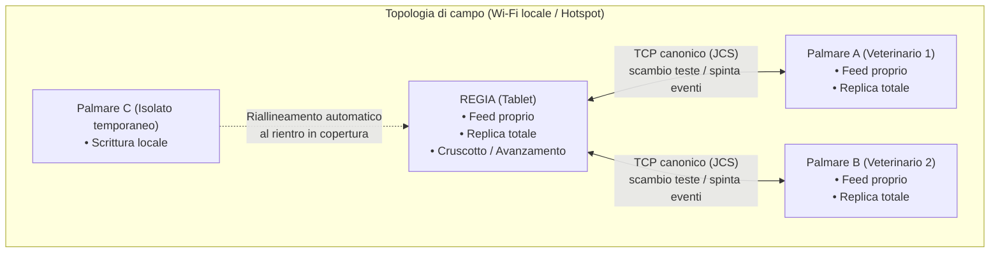
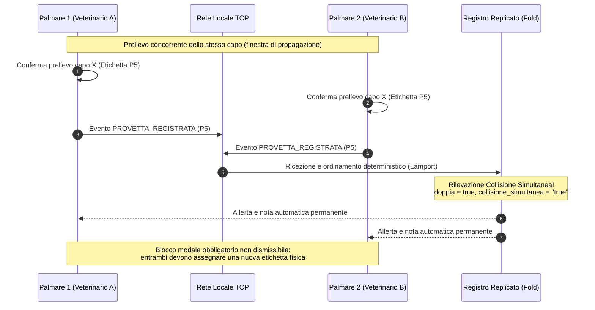
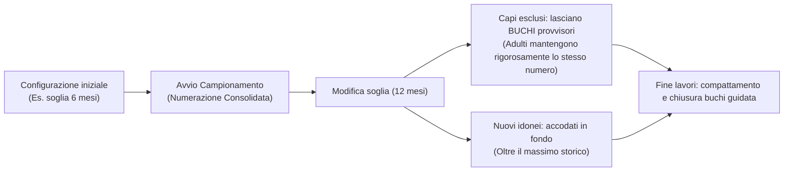
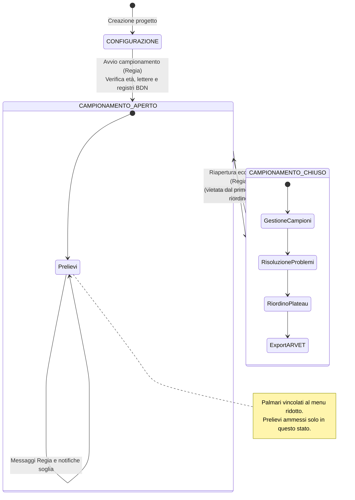
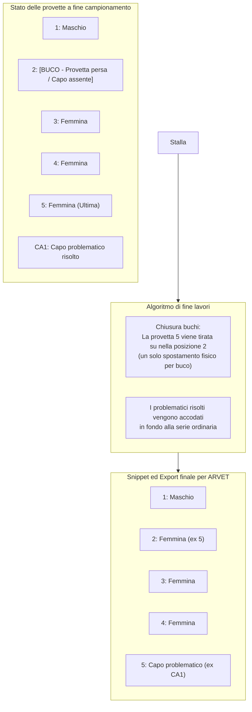

# Sotto il cofano: problemi affrontati e architettura

Come Fejalog risponde ai vincoli del lavoro sul campo per garantire integrità, sincronizzazione e zero perdite di dati.

## Indice delle sezioni tecniche

- [Il contesto reale: il campo vs il laboratorio](#il-contesto-reale-il-campo-vs-il-laboratorio)
- [1. Consenso distribuito senza Internet e senza Single Point of Failure](#1-consenso-distribuito-senza-internet-e-senza-single-point-of-failure)
- [2. Unicità assoluta dei numeri e prevenzione delle collisioni](#2-unicita-assoluta-dei-numeri-e-prevenzione-delle-collisioni)
- [3. Persistenza a strati e salvaguardia del dato («Rischio zero»)](#3-persistenza-a-strati-e-salvaguardia-del-dato-rischio-zero)
- [4. Immutabilità dei progressivi a fronte di cambi di configurazione in corsa](#4-immutabilita-dei-progressivi-a-fronte-di-cambi-di-configurazione-in-corsa)
- [5. Multi-stabilimento e greggi promiscui (Comproprietà e pascoli)](#5-multi-stabilimento-e-greggi-promiscui-comproprieta-e-pascoli)
- [6. Fasi operative rigide e prevenzione dell'errore umano](#6-fasi-operative-rigide-e-prevenzione-dellerrore-umano)
- [7. Riconciliazione finale con ARVET e chiusura buchi](#7-riconciliazione-finale-con-arvet-e-chiusura-buchi)
- [8. Ergonomia di campo, hardware e consumo energetico](#8-ergonomia-di-campo-hardware-e-consumo-energetico)
- [Riepilogo sintetico dei problemi e delle risposte architetturali](#riepilogo-sintetico-dei-problemi-e-delle-risposte-architetturali)

---

## Il contesto reale: il campo vs il laboratorio

La profilassi di massa degli ovicaprini (prelievo di sangue per la diagnosi della brucellosi) si svolge in condizioni ambientali operative molto distanti dall'ufficio o dal laboratorio:

- **Ambiente avverso**: recinti polverosi o fangosi, animali in movimento rapido, freddo o caldo intenso, veterinari muniti di guanti di protezione;
- **Assenza di connettività**: pascoli montani e stabilimenti rurali spesso privi di copertura cellulare o con segnale instabile;
- **Hardware eterogeneo**: tablet di servizio con risorse limitate (es. Lenovo Tab M10), smartphone personali dei veterinari, lettori elettronici di bolo/transponder Bluetooth;
- **Vincolo primario inderogabile**: il numero scritto col pennarello indelebile sulla provetta di vetro comanda su tutto. L'intero sistema informatico serve a garantire che quel campione arrivi integro, univoco e perfettamente riconciliato nel sistema informativo veterinario nazionale (ARVET/BDN).

Di seguito vengono analizzate le principali sfide affrontate da Fejalog e le soluzioni ingegneristiche adottate per soddisfare tutti i requisiti di sistema.

---

## 1. Consenso distribuito senza Internet e senza Single Point of Failure

### Il problema
In campo lavorano contemporaneamente più veterinari (ciascuno con un palmare o smartphone) e un coordinatore con il tablet (la **Regia**). Un'architettura client-server convenzionale basata sul cloud è impraticabile per mancanza di connettività Internet. D'altra parte, affidarsi ciecamente a un unico server locale espone al rischio di **Single Point of Failure (SPOF)**: se il tablet della Regia esaurisce la batteria o si spegne improvvisamente, le squadre di prelievo non possono e non devono fermarsi.

### La soluzione adottata
Fejalog implementa una **topologia peer-to-peer a stella riconfigurabile** basata su **Event Sourcing** crittografico («il libro mastro»):



1. **Replica totale del registro**: ogni dispositivo conserva una copia integrale e speculare di tutti gli eventi della seduta;
2. **Feed append-only per dispositivo**: ogni nodo scrive esclusivamente nel proprio feed sequenziale, concatenando gli eventi tramite hash crittografici SHA-256 (`prev_hash -> hash`) in JSON canonico (RFC 8785 / JCS). Non esistono sovrascritture né cancellazioni;
3. **Protocollo TCP a basso overhead**: la comunicazione locale avviene su socket TCP diretti (porta 47800) protetti da HMAC di sessione generato all'ingresso tramite QR code, senza pesanti stack di rete terzi;
4. **Regia cedibile e resiliente**: se il tablet della Regia si spegne, i palmari continuano a lavorare salvando gli eventi in locale. Qualsiasi palmare può prendere il ruolo di Regia (`Prendi la Regia`), oppure i nodi si riallineano deterministicamente non appena il tablet torna operativo.

---

## 2. Unicità assoluta dei numeri e prevenzione delle collisioni

### Il problema
Due veterinari posizionati ai capi opposti della manica di cattura prelevano decine di animali al minuto. Il sistema deve impedire categoricamente che:
- Due provette ricevano lo stesso identificativo;
- Un veterinario debba correggere o rinumerare un campione già etichettato col pennarello durante il campionamento (REQ-NUM-01).

La sfida si aggrava quando un veterinario si allontana temporaneamente dal raggio della Wi-Fi lavorando in **isolamento**, oppure quando due veterinari confermano quasi all'unisono lo stesso capo prima che il pacchetto TCP di sincronizzazione sia recapitato.

### La soluzione adottata



1. **Numerazione deterministica al caricamento dei registri**: all'avvio della seduta, i capi presenti e in età diagnostica ricevono un progressivo potenziale naturale `1..N` (con i maschi in testa per preservare il blocco profilassi *Brucella ovis*). Non ci sono contese di blocchi o riserve dinamiche durante il prelievo;
2. **Disgiunzione assoluta dei namespace (Lettere)**:
   - Lettere per stabilimenti secondari: riservate all'insieme `XYWVURNKH`;
   - Lettere per i veterinari (identificazione campioni problematici): riservate all'insieme `ADEFJM...`;
   - L'intersezione tra i due insiemi è rigorosamente vuota: non può mai verificarsi ambiguità tra un plateau di stabilimento secondario e il codice di un veterinario;
3. **Prelievi in isolamento con lettera del veterinario**: quando un dispositivo non ha collegamento di rete (`isolato = true`), i prelievi portano automaticamente in coda la lettera del veterinario (es. `P5A`). In questo modo, anche se due veterinari operassero completamente sconnessi, non genererebbero mai etichette fisiche sovrapposte;
4. **Gestione deterministica delle collisioni simultanee**:
   - Qualora due nodi allineati in rete confermino simultaneamente lo stesso capo prima della replica TCP, il fold deterministico identifica l'anomalia;
   - Viene apposta automaticamente su entrambi i record la nota di audit:
     `"Collisione per riutilizzo simultaneo con provetta [etichetta] registrata da [veterinario]"`;
   - Un avviso modale obbligatorio non dismissibile (`AlertDialog`) si apre sui display di entrambi i veterinari, impedendo ulteriori inserimenti finché la provetta non viene rinominata con una nuova etichetta distintiva;
5. **Tracciabilità visiva nel Plateau**: nella vista Plateau della Regia, ogni provetta con note o collisioni simultanee è contrassegnata da un **pallino giallo** ed è consultabile nell'apposito pannello **Note plateau**.

---

## 3. Persistenza a strati e salvaguardia del dato («Rischio zero»)

### Il problema
In campo i dispositivi possono cadere a terra, bagnarsi, spegnersi per esaurimento repentino della carica o subire riavvii forzati da parte del sistema operativo per ottimizzazione termica. La corruzione del database o la perdita di provette registrate comporta l'annullamento dell'intera giornata di lavoro o la necessità di ricatturare gli animali.

### La soluzione adottata
Fejalog adotta una persistenza ridondante a più strati:

```
[UI Interfaccia] ──── (1) Tap veterinario
       │
[Scrittura JSONL] ─── (2) Append sul feed locale
       │
[Fsync fisico] ────── (3) Sincronizzazione blocchi disco (fsync)
       │
  ✓ Mostrato a schermo (Dato sicuro al 100% in locale)
       │
[Diffusione TCP] ──── (4) Spinta pacchetto ai peer collegati
       │
[Fsync remoto] ────── (5) Scrittura e fsync sui nodi remoti
       │
 ✓✓ Mostrato a schermo (Dato replicato e convalidato dal gruppo)
```

1. **`fsync` sincrono obbligatorio**: la spunta di avvenuta registrazione (✓) appare sul display solo dopo che il file system Android ha completato l'operazione di `fsync` fisico sui blocchi di memoria flash. Se manca l'energia prima del completamento, l'operazione non è registrata e il veterinario non riceve conferma fasulla;
2. **Doppia conferma distribuita (✓✓)**: la seconda spunta attesta che l'evento è stato ricevuto, convalidato crittograficamente e reso durevole tramite `fsync` anche sulla Regia e sugli altri nodi della rete;
3. **Doppio archivio parallelo**:
   - Storage privato dell'applicazione;
   - Cartella pubblica `Documents/Fejalog/<sessione>/` (MediaStore), che garantisce la sopravvivenza dei dati anche in caso di disinstallazione involontaria o reset dei dati dell'app;
4. **Istantanee e riconciliazione automatica**: salvataggio automatico di archivi compressi protetti da manifesto crittografico (`fejalog-backup`) a intervalli regolari (es. ogni 25 eventi). In caso di disconnessioni prolungate o recupero di backup parziali da dispositivi superstiti, il motore `BackupSeduta.unisci` unifica le catene senza alcuna perdita di eventi.

---

## 4. Immutabilità dei progressivi a fronte di cambi di configurazione in corsa

### Il problema
Durante il campionamento sul campo possono verificarsi variazioni rispetto alla pianificazione d'ufficio:
- Il veterinario ufficiale decide di modificare la soglia di età diagnostica (es. da 12 mesi a 6 mesi per accertato pascolo vagante, o viceversa);
- Vengono reperiti sul posto registri BDN cartacei o file integrativi per animali non presenti nell'estrazione iniziale.

Se l'applicazione ricalcolasse la numerazione da capo, i progressivi assegnati ai capi cambierebbero, rendendo errate e inservibili tutte le provette già etichettate col pennarello nei plateau.

### La soluzione adottata
Il motore di numerazione di Fejalog garantisce l'**immutabilità assoluta dei progressivi consolidati**:



1. **Consolidamento all'avvio**: l'avvio della fase operativa fissa l'assegnazione dei numeri naturali `1..N`;
2. **Invarianza degli adulti**: un innalzamento dell'età diagnostica (6→12 mesi) esclude i giovani, ma non scala mai i numeri dei capi adulti (il capo col numero 2 resta tassativamente 2, senza diventare 1);
3. **Buchi provvisori non distruttivi**: gli animali esclusi dall'innalzamento della soglia lasciano provvisoriamente dei buchi nella sequenza, che verranno gestiti e compattati solo a fine lavori;
4. **Accodamento dei nuovi capi idonei**: l'abbassamento della soglia o l'aggiunta di nuovi registri BDN accoda i nuovi idonei partendo da `max(massimoStorico, provetteUsate) + 1`;
5. **Reversibilità**: se la soglia viene ripristinata (6→12→6 mesi), ogni capo riprende esattamente il proprio numero progressivo originario.

---

## 5. Multi-stabilimento e greggi promiscui (Comproprietà e pascoli)

### Il problema
Nelle aree alpine e negli alpeggi è frequente risanare contemporaneamente greggi promiscui appartenenti a proprietari o codici stabilimento differenti.
Esistono due fattispecie radicalmente diverse che richiedono trattamenti distinti:
1. **Altro risanamento svolto in contemporanea**: un intero gregge con codice BDN diverso risanato nello stesso intervento, che richiede provette separate e una propria distinta di accettazione ARVET;
2. **Singoli capi compravenduti o estranei**: singoli animali presenti nel gregge privi di passaggio di proprietà perfezionato in BDN.

### La soluzione adottata

| Caso operativo | Strumento Fejalog | Lettera e serie | Destinazione ARVET |
|---|---|---|---|
| **Altro risanamento in contemporanea** | **Stabilimento secondario** (aggiunto in corsa da dropdown BDN) | Lettera dedicata di stabilimento: `X1`, `X2`, `XC12` | Accettazione separata autonoma per lo stabilimento secondario |
| **Singolo capo estraneo / compravendita** | **DDA individuale** o provetta problematica dello stabilimento di lavoro | Lettera del veterinario o prefisso specie (es. `CA1`, `P25`) | Confluisce nei problematici dello stabilimento prescelto |
| **Capo appartenente a registro non in campionamento** | Riconoscimento automatico con **banda viola** | Provetta problematica (`altro_stabilimento`) | Gestito dalla Regia nella risoluzione problemi |

- **Stabilimenti secondari solo aggiungibili**: uno stabilimento secondario può essere aggiunto in corsa ma mai rimosso durante il campionamento, preservando l'integrità dei record;
- **Spostamento manuale tracciato**: se un veterinario attribuisce erroneamente una provetta a uno stabilimento anziché all'altro, la Regia o il palmare possono effettuare lo spostamento manuale; l'app preserva il legame storico con la BDN d'origine aggiornando coerentemente la serie e l'export finale.

---

## 6. Fasi operative rigide e prevenzione dell'errore umano

### Il problema
La concitazione delle operazioni di campo aumenta la probabilità di tocchi accidentali sullo schermo, avvii prematuri prima della configurazione dei parametri di profilassi o tentativi di riordino a campionamento ancora aperto.

### La soluzione adottata
Una **macchina a stati finiti formale** governa il ciclo di vita della seduta:



1. **Blocco dei palmari non allineati**: un palmare non può accedere alla schermata di campionamento finché non ha configurato l'identità del veterinario, ricevuto il pacchetto e il registro sincronizzato, e verificato che la seduta sia formalmente in `CAMPIONAMENTO_APERTO`;
2. **Congelamento dei parametri strutturali**: all'avvio del campionamento, le lettere di specie e lo stabilimento principale sono congelati nel fold del registro e non possono essere alterati;
3. **Menu differenziato e mirato**: durante i prelievi, il palmare visualizza solo i comandi strettamente operativi (`Campionamento`, `Ultime`, `Avanzamento`, `Rete`), evitando interferenze con le impostazioni globali;
4. **Sblocco controllato e chiusura definitiva**: le sezioni di `Soluzione problemi`, `Riordino plateau` e `Esportazioni ARVET` sono rigorosamente inaccessibili finché il campionamento non viene chiuso dalla Regia; dal primo evento del riordino (spunta, spostamento, scambio) la chiusura diventa categoricamente definitiva e irreversibile.

---

## 7. Riconciliazione finale con ARVET e chiusura buchi

### Il problema
Il sistema informativo ARVET dell'Istituto Zooprofilattico accetta unicamente serie di provette continue, lineari e crescenti da `1` a `n` per ciascun invio (pecore, capre, maschi *Brucella ovis*). Non sono ammessi buchi, salti o etichette alfanumeriche complesse.
In campo, al contrario, si generano inevitabilmente provette rotte, buchi da capi non presenti, provette da isolato e campioni problematici.

### La soluzione adottata
Il modulo di fine lavori applica un algoritmo deterministico di sistemazione geometrica:



1. **Chiusura dei buchi interni**: l'algoritmo riempie i vuoti interni tirando su le provette dal fondo della serie ordinaria con **un solo spostamento per provetta**, minimizzando la riscrittura fisica dei campioni da parte del veterinario;
2. **Guida al riposizionamento**: l'app genera una matrice dettagliata di spostamento (`da provetta X a provetta Y`, con coordinate di plateau) che guida visivamente la riorganizzazione fisica dei pozzetti;
3. **Snippet JavaScript per ARVET**: generazione di script idempotenti per la console del browser, che automatizzano l'inserimento sequenziale dei numeri di provetta ed eseguono l'aggiunta automatica dei capi mancanti tramite le funzioni di pagina di ARVET, azzerando i tempi di trascrizione manuale.

---

## 8. Ergonomia di campo, hardware e consumo energetico

### Il problema
Le batterie degli smartphone si degradano rapidamente alle basse temperature invernali tipiche della profilassi. Schermi sempre accesi, frequenti richieste di geolocalizzazione o scansioni di rete continue possono esaurire la carica in meno di due ore. Inoltre, i veterinari che indossano guanti non possono eseguire gesti complessi su touchscreen umidi.

### La soluzione adottata
1. **Zero polling e zero wake-lock**: Fejalog non mantiene lo schermo costantemente forzato né esegue cicli di polling a vuoto. Le connessioni TCP sono reattive su socket bloccanti in attesa di eventi;
2. **Telemetria passiva della batteria**: il livello di carica di ogni palmare (`bat: {l, c}`) viene trasmesso unicamente come metadato opzionale nei normali pacchetti di sincronizzazione, consentendo alla Regia di monitorare lo stato di tutti i dispositivi senza inviare messaggi dedicati;
3. **Supporto lettori Bluetooth HID**: l'app accetta input diretto da lettori di transponder auricolari e ruminali conformi ISO 11784/11785 (es. Allflex AWR250) configurati come tastiera Bluetooth, con pulizia automatica di codici paese e spaziature;
4. **Interfaccia ad alto contrasto**: layout Material 3 conformi agli standard WCAG AAA con numeri di provetta sovradimensionati e bande colorate ad alta saturazione, chiaramente distinguibili anche sotto la luce solare diretta.

---

## Riepilogo sintetico dei problemi e delle risposte architetturali

| Problema reale di campo | Vincolo operativo | Risposta ingegneristica di Fejalog |
|---|---|---|
| **Assenza di connessione Internet** | Nessun accesso a server remoti o cloud | Architettura peer-to-peer locale su Wi-Fi; replica totale del registro crittografico. |
| **Possibile spegnimento del tablet (Regia)** | Nessun Single Point of Failure | Topologia a stella cedibile; ogni palmare numera in locale e può subentrare come Regia. |
| **Rischio di doppie numerazioni** | Unicità assoluta e definitiva (REQ-NUM-01) | Numerazione pre-assegnata 1..N; lettere stabilimenti e veterinari disgiunte; prelievi isolati con lettera del veterinario. |
| **Prelievi simultanei non sincronizzati** | Concorrenza nella finestra TCP | Rilevamento automatico collisioni; nota permanente; blocco modale obbligatorio di rinomina. |
| **Crash improvviso o scarica batteria** | Tolleranza totale alla perdita dati | Scrittura sincrona con `fsync` a disco; conferma distribuita (✓✓); doppio archivio persistente. |
| **Modifica età diagnostica in corsa** | Non alterare i numeri già scritti | Numerazione consolidata all'avvio; capi adulti invariabili; buchi provvisori; accodamento nuovi idonei. |
| **Greggi promiscui e comproprietà** | Distinte e fatturazioni ARVET separate | Stabilimenti secondari dedicati (solo aggiungibili); serie a lettere (`X1`); DDA individuali per singoli capi estranei. |
| **Buchi e salti nella numerazione** | ARVET accetta solo serie lineari 1..n | Algoritmo di riordino geometrico dei plateau; chiusura buchi dal fondo; guida al riposizionamento; snippet ARVET. |
