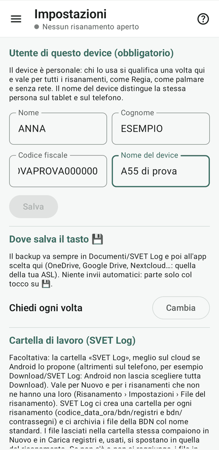

# 1 · Chi usa il device

**Obiettivo**: ogni device sa chi lo usa. Si fa una volta sola e vale per tutti i progetti.

**Ti serve**: ogni device, nelle mani di chi lo userà.

## Fai

1. Menu ☰ › **Impostazioni › Utente**.
2. Scrivi **nome, cognome e codice fiscale**. Se il tablet ha già l'elenco dei veterinari dell'ASL, «Scegli
   dall'elenco dei veterinari» li compila senza errori.
3. In **Impostazioni › Dispositivo** scrivi il **nome del device**: «Tablet Regia», «A55 Mario». Qui trovi anche la checklist del telefono e la prova del telecomando.
4. In **Impostazioni › Cartelle** configuri la cartella locale dei backup e la cartella remota; in **Impostazioni › App** regoli lo scorrimento fra pecore e capre, la vibrazione, le statistiche in tempo reale e la diagnostica.

<figure markdown="span">
  
  <figcaption>Impostazioni: chi usa il device e il suo nome</figcaption>
</figure>

!!! atteso "Cosa devi vedere"
    Nell'**Avvio rapido** il primo passo, «Chi usa questo device», è fatto. Nel progetto i nomi si mostrano corti,
    «Mario R».

!!! info "Il codice fiscale"
    Serve a riconoscere il veterinario nell'elenco e finisce nel nome dei file di backup, per sapere chi li ha salvati.
    Non va mai sulle provette né negli export.

## Fatto?

- [ ] utente e nome del device su ogni device
