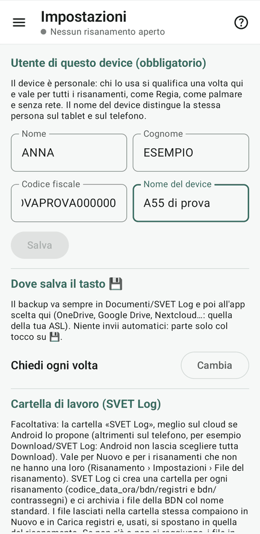

# 1 · Chi usa il device

**Obiettivo**: ogni device sa chi lo usa. Si fa una volta sola e vale per tutti i progetti.

**Ti serve**: ogni device, nelle mani di chi lo userà.

## Fai

1. Menu ☰ › **Impostazioni** (del device).
2. Scrivi **nome, cognome e codice fiscale**. Se il tablet ha già l'elenco dei veterinari dell'ASL, «Scegli
   dall'elenco dei veterinari» li compila senza errori.
3. Scrivi il **nome del device**: «Tablet Regia», «A55 Mario».
4. Guarda le altre impostazioni: dove salva il tasto 💾, lo scorrimento fra pecore e capre, le statistiche in tempo
   reale.

<figure markdown="span">
  
  <figcaption>Impostazioni: chi usa il device e il suo nome</figcaption>
</figure>

!!! atteso "Cosa devi vedere"
    Nell'**Avvio rapido** il primo passo, «Chi usa questo device», è fatto. Nel progetto i nomi si mostrano corti,
    «Mario R».

!!! info "Il codice fiscale"
    Serve a riconoscere il veterinario nell'elenco e finisce nel nome dei file di backup, per sapere chi li ha salvati.
    Non va mai sulle provette né negli export.

## Fatto?

- [ ] utente e nome del device su ogni device
