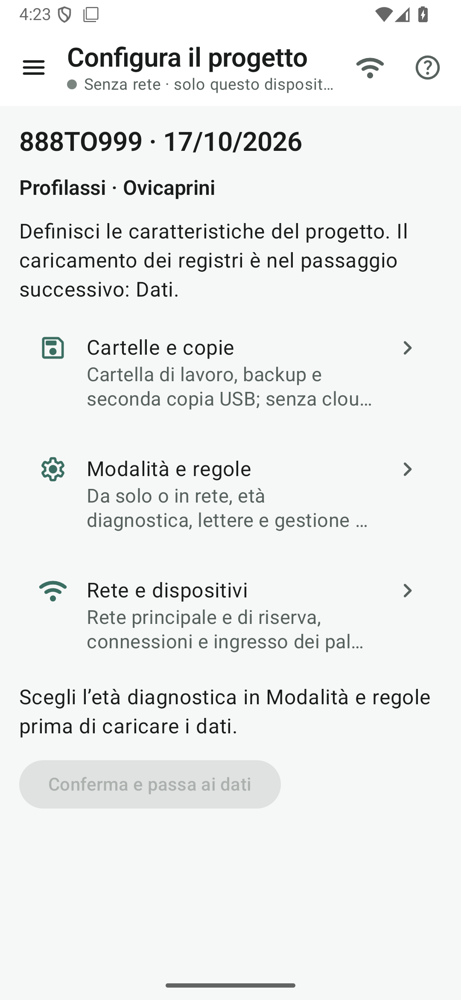

# 2 · Crea e configura il progetto

**Obiettivo:** creare un progetto vuoto per lo stabilimento fittizio 888TO999 e prepararlo prima dei dati.

## Crea

1. Senza un progetto aperto, Menu ☰ › **Nuovo progetto**.
2. Indica **888TO999** come stabilimento di lavoro, la data e una descrizione facoltativa. Il tipo disponibile è **Profilassi ovicaprini**.
3. Tocca **Crea e configura**. Non servono ancora i file della BDN.

## Configura

Da **Configurazione**:

1. **Parametri e regole (1):** scegli l'età diagnostica, le lettere di specie, il verso di riempimento, le regole per i fuori registro e il backup automatico. Le cartelle dell'applicazione (locale per i backup e remota per i dati BDN) vengono configurate una volta sola in **Impostazioni › Cartelle** con permessi persistenti Android; all'uscita dal lavoro non serve selezionare cartelle.
2. **Sigle stabilimenti e veterinari (2):** controlla lo stabilimento principale e gli eventuali secondari, le lettere assegnate alle serie e le sigle dei veterinari prelevatori.
3. **Dati input (3):** carica registri BDN, contrassegni ed eventuali capi ricercati.
4. **Rete del progetto (4):** se lavori con più device, definisci la modalità di rete e le reti del progetto (router, hotspot del tablet), da salvare su ogni telefono col loro QR Wi-Fi; i palmari entreranno da qui (o con **QR d'ingresso**).
5. Tocca **5. Checklist e avvio** per i controlli finali.

<figure markdown="span">
  
  <figcaption>Il progetto esiste già; prima si completa la configurazione.</figcaption>
</figure>

## Poi carica i dati

Da **Configurazione › 3. Dati input** (Registri BDN e contrassegni), scegli tutti i file di `bdn/` estratti dal kit a cinque stabilimenti:

- registri di pecore e capre di **888TO999**;
- registri degli altri quattro stabilimenti di lavoro **888TO888**, **888TO777**, **888TO666**, **888TO555**;
- registri di **888TO222** e dei chiusi **888TO444** e **888TO333**, che restano di riferimento;
- contrassegni disponibili di pecore e capre.

Controlla l’anteprima e applica il caricamento. Per reperire gli input veri, segui [Scaricare i file dalla BDN](file-bdn.md).
I successivi aggiornamenti si fanno sempre in **3. Dati input**: i numeri già assegnati restano conservati.

!!! atteso "Cosa devi vedere"
    Il progetto esiste prima dell’importazione. Dopo il caricamento, 888TO999 ha **1050 ovini e 150 capre presenti**, **10 e 4 contrassegni disponibili**; 888TO555 ha **8 ovini e 2 capre**.
    In **Configurazione › 2. Sigle stabilimenti e veterinari**, prima dell’avvio, includi anche 888TO888 (X), 888TO777 (Y), 888TO666 (W) e 888TO555 (V).
    In alternativa apri il pacchetto già preparato, che contiene tutti e cinque gli stabilimenti di lavoro.

??? tip "Se hai già un progetto"
    Usa **Apri progetto** per un backup oppure un pacchetto già preparato in svet-tools. **Recenti** riapre i progetti presenti sul dispositivo. Rivedi la configurazione, poi passa ai dati. Per cambiare progetto devi prima usare **Esci dal progetto**: a progetto aperto gli accessi a Nuovo, Apri, Recenti ed Entra col QR non compaiono.

??? failure "C’è già un progetto aperto"
    Prima usa **menu › Esci dal progetto**. Il progetto resta nei Recenti.

## Fatto?

- [ ] progetto creato vuoto
- [ ] cartelle, modalità e regole definite
- [ ] dati caricati e anteprima controllata
