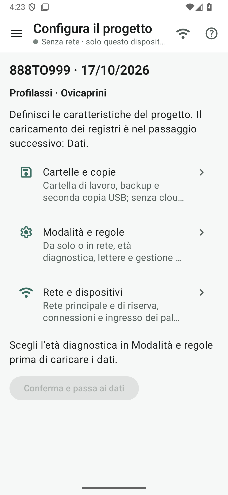

# 2 · Crea e configura il progetto

**Obiettivo:** creare un progetto vuoto per lo stabilimento fittizio 888TO999 e prepararlo prima dei dati.

## Crea

1. Menu ☰ › **Progetto › Nuovo progetto**.
2. Indica **888TO999** come stabilimento di lavoro, la data e una descrizione facoltativa. Il tipo disponibile è **Profilassi ovicaprini**.
3. Tocca **Crea e configura**. Non servono ancora i file della BDN.

## Configura

Da **Preparazione › Configura il progetto**:

1. **Cartelle e copie:** scegli la cartella del progetto, eventualmente cloud, e le copie desiderate. Senza una cartella disponibile, i file restano sul dispositivo. Puoi scegliere anche una seconda cartella su USB.
2. **Modalità e regole:** scegli l’età diagnostica, le lettere di specie e le regole per i problematici. Definisci se lavorare da solo, con Wi-Fi locale o con hotspot.
3. **Rete e dispositivi:** se lavori con più device, prepara la rete principale e quella di riserva; i palmari entreranno da qui.
4. Tocca **Conferma e passa ai dati**.

<figure markdown="span">
  
  <figcaption>Il progetto esiste già; prima si completa la configurazione.</figcaption>
</figure>

## Poi carica i dati

Da **Dati › Registri BDN e contrassegni**, scegli i cinque file di `kit_prova/bdn/`:

- registri di pecore e capre di **888TO999**;
- registro di **888TO888** come altro stabilimento di riferimento;
- contrassegni disponibili di pecore e capre.

Controlla l’anteprima e applica il caricamento. Per reperire gli input veri, segui [Scaricare i file dalla BDN](file-bdn.md).
I successivi aggiornamenti si fanno sempre in Dati: i numeri già assegnati restano conservati.

!!! atteso "Cosa devi vedere"
    Il progetto esiste prima dell’importazione. Dopo il caricamento, 888TO999 ha **233 pecore e 42 capre presenti**, **10 e 5 contrassegni disponibili**; 888TO888 ha 6 pecore.

??? tip "Se hai già un progetto"
    Usa **Progetto › Apri progetto** per un backup oppure un pacchetto già preparato in svet-tools. **Recenti** riapre i progetti presenti sul dispositivo. Rivedi la configurazione, poi passa ai dati.

??? failure "C’è già un progetto aperto"
    Prima usa **Progetto › Chiudi progetto**. Il progetto resta nei Recenti.

## Fatto?

- [ ] progetto creato vuoto
- [ ] cartelle, modalità e regole definite
- [ ] dati caricati e anteprima controllata
