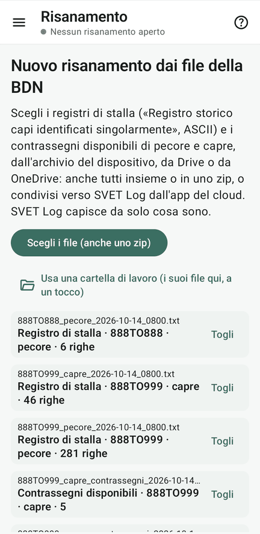
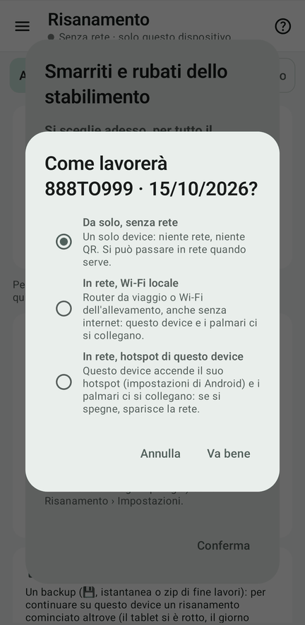
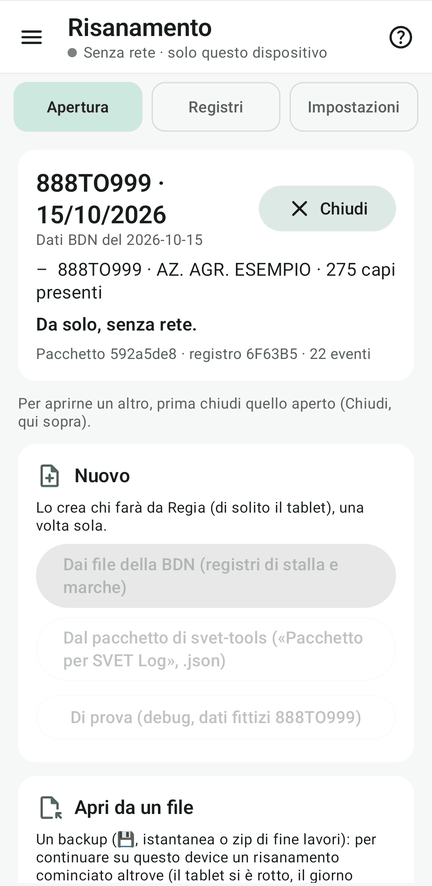

# 2 · Il risanamento

**Obiettivo**: la Regia crea il risanamento di 888TO999 dai file della BDN del kit.

**Ti serve**: il tablet della Regia, col kit aperto.

## Fai

1. Menu ☰ › **Risanamento** › scheda «Apertura e chiusura» (sul telefono «Apertura») › **Nuovo** › «Dai file della
   BDN».
2. Scegli i **cinque file** di `kit_prova/bdn/`: puoi sceglierli tutti insieme, e Fejalog capisce da solo che cosa
   sono.
    - `registri/888TO999_pecore_….txt`, `registri/888TO999_capre_….txt`: lo stabilimento di lavoro;
    - `registri/888TO888_pecore_….txt`: il pascolo condiviso;
    - `contrassegni/888TO999_pecore_contrassegni_….txt`, `…_capre_contrassegni_….txt`: le marche disponibili.
3. Controlla la tabella: 888TO999 **di lavoro**, 888TO888 **altro stabilimento**. Sotto, scegli l'**età diagnostica** (default: 6 mesi vagante o 12 mesi stanziale) e la **lettera di specie** (default applicata alla specie meno numerosa, `C` per capre).
4. **«Crea pacchetto e inizia»** e scegli come si lavora: **da solo**, oppure **in rete** (Wi-Fi locale o hotspot di
   questo tablet). Per il tutorial con più device: in rete.

<figure markdown="span">
  
  <figcaption>I cinque file, riconosciuti da soli</figcaption>
</figure>

<figure markdown="span">
  
  <figcaption>La tabella prima di creare: «—» se il file non c'è</figcaption>
</figure>

<figure markdown="span">
  
  <figcaption>Da solo o in rete</figcaption>
</figure>

<figure markdown="span">
  
  <figcaption>Il risanamento aperto: «888TO999 · data»</figcaption>
</figure>

!!! atteso "Cosa devi vedere"
    - Il risanamento si chiama **«888TO999 · data di oggi»**.
    - In Risanamento › **Registri**, 888TO999 ha **233 pecore e 42 capre presenti**, **10 e 5 contrassegni
      disponibili**; 888TO888 ha 6 pecore.

??? tip "In alternativa: il pacchetto"
    Nuovo › Dal pacchetto, con `kit_prova/pacchetto_888TO999_kit.json`: è lo stesso risanamento, già coi ricercati.

??? failure "Se non va"
    - **Un file non viene riconosciuto**: deve essere uno dei file `.txt` del kit così com'è, senza modifiche.
    - **Non c'è il tasto Nuovo**: c'è già un risanamento aperto; chiudilo (Chiudi, accanto al nome).

## Fatto?

- [ ] risanamento 888TO999 creato sul tablet
- [ ] i numeri della tabella dei registri tornano
