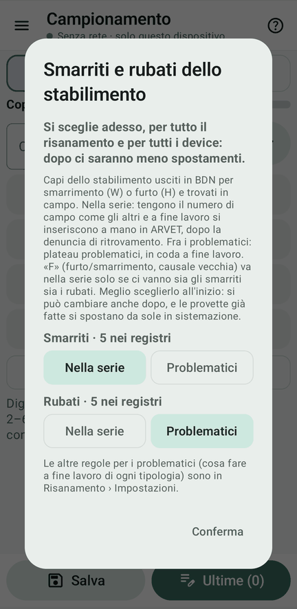
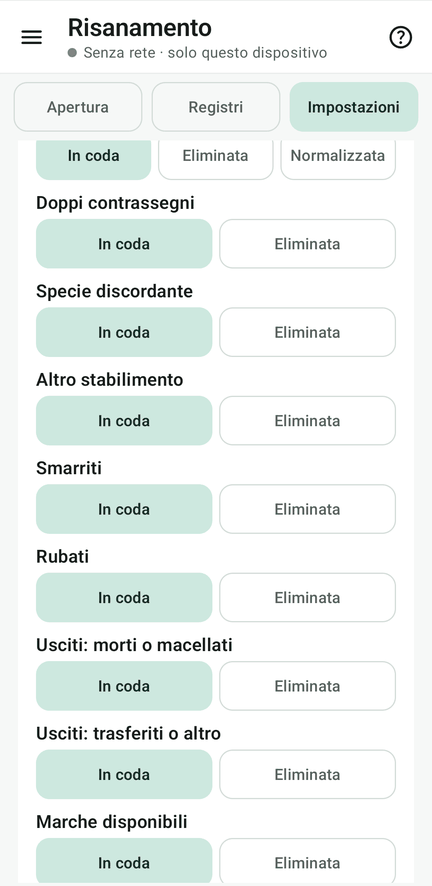

# 3 · Registri e regole

**Obiettivo**: la Regia fissa le regole per i problematici prima della prima provetta e sa dove stanno i file della
BDN.

**Ti serve**: il tablet della Regia.

## Fai

1. Appena creato il risanamento, Fejalog chiede **«Smarriti e rubati dello stabilimento»**: capi usciti in BDN per
   smarrimento (W) o furto (H) e ritrovati in campo. Lascia il predefinito, smarriti **nella serie** e rubati
   **problematici**, e **Conferma**. La finestra non si chiude finché non si sceglie.
2. Risanamento › **Impostazioni** › **Regole per i problematici**: per ogni **tipologia** (doppi, specie discordante,
   altro stabilimento, usciti morti o trasferiti, marche disponibili…) che cosa fare a fine lavoro: **in coda** o
   **eliminata**. Lascia «in coda».
3. Sempre in Impostazioni, il **backup automatico**: di base un'istantanea ogni 25 eventi.
4. Risanamento › **Registri** › «Fonti del risanamento»:
    - **senza cartella di lavoro**, i file usati sono copiati in `Download/Fejalog/‹risanamento›/bdn`;
    - **con una cartella di lavoro** (la cartella «Fejalog», meglio sul cloud), Fejalog ci crea la cartella del
      risanamento con `bdn/registri` e `bdn/contrassegni`, dà ai file il **nome standard** e ne mostra lo stato.

<figure markdown="span">
  
  <figcaption>Smarriti e rubati: si sceglie subito</figcaption>
</figure>

<figure markdown="span">
  
  <figcaption>Le regole per tipologia</figcaption>
</figure>

!!! atteso "Cosa devi vedere"
    Le regole sono quelle predefinite, e sugli altri device (quando entreranno) si vedono ma non si cambiano. Le
    impostazioni del risanamento le cambia solo la Regia.

!!! info "Si possono cambiare dopo"
    Scegliere all'inizio fa meno spostamenti a fine lavoro, ma le regole si possono cambiare anche dopo: le provette
    già fatte seguono da sole in sistemazione.

## Fatto?

- [ ] smarriti e rubati confermati
- [ ] regole per i problematici viste
