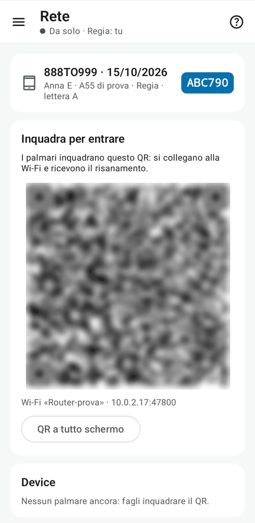

# 4 · La rete

**Obiettivo**: i palmari entrano nel progetto della Regia e hanno il registro intero.

**Ti serve**: il tablet della Regia e i telefoni dei palmari, sulla stessa Wi-Fi o vicino al tablet (hotspot).

## Fai

=== "Regia"

    1. Se hai scelto «in rete» quando hai creato il progetto, la rete è già aperta; altrimenti apri menu ☰ › **Configurazione › 4. Rete del progetto**.
    2. Con l'**hotspot del tablet**, Android chiede la **localizzazione accesa** (serve per l'hotspot).
    3. Prima del lavoro, in **Rete del progetto** scegli le reti del progetto (router, hotspot del tablet) e tocca **QR** accanto a ognuna: ogni telefono lo inquadra con la fotocamera e Android salva la rete.
    4. Mostra il QR per i palmari: tocca il tasto del QR in Rete del progetto, oppure apri la voce dedicata **Configurazione › QR d'ingresso** (raggiungibile anche toccando l'icona della rete in alto). Il QR segue da solo la Wi-Fi in cui è il tablet.
    5. Quando un palmare chiede di entrare, in ogni pagina compare «Chiede di entrare»: **«Fai entrare»**.

=== "Palmari"

    1. Prima di tutto salva le reti del progetto: inquadra con la fotocamera i loro QR Wi-Fi, mostrati dalla Regia.
    2. Senza un progetto aperto, Menu ☰ › **Entra col QR**: inquadra il QR mostrato dalla Regia; se il telefono è già sulla sua Wi-Fi riceve subito il progetto, altrimenti tocca nel pannello la rete indicata.
    3. In alternativa, se il telefono è già sulla Wi-Fi della Regia, apri la voce diretta **Rete** e tocca **«Chiedi di entrare»** accanto al progetto rilevato.
    4. In **Impostazioni › Dispositivo**, controlla la checklist del telefono: Wi-Fi senza internet, batteria senza restrizioni, notifiche (il [foglio per i veterinari](../veterinari.md)) e la prova del telecomando.

<figure markdown="span">
  
  <figcaption>La pagina Rete della Regia: il QR (qui sfocato) e i device</figcaption>
</figure>

!!! atteso "Cosa devi vedere"
    - Sotto il titolo di ogni pagina, il **pallino verde** e chi ha la regia.
    - Sulla Regia, in **4. Rete del progetto**, i palmari coi loro nomi e il loro stato.
    - Ogni veterinario ha una **sigla** di due lettere assegnata automaticamente dalla Regia (per esempio UV): resta la stessa anche se cambia telefono, e statistiche e classifica seguono la persona (codice fiscale). Nei progetti precedenti alle sigle restano le lettere previste all'inizio.
    - Sui palmari, al posto di Salva, **«✓ Allineato»**: il registro è uguale a quello della Regia.

??? failure "Se non va"
    - **L'hotspot non parte**: accendi la localizzazione e dai il permesso a Fejalog.
    - **Il progetto non compare da solo**: inquadra il QR con **Entra col QR**.
    - **Cambiare rete in corsa**: la Wi-Fi la sceglie Android; se il router cade i telefoni passano da soli a un'altra rete salvata. Per spostare tutti, la Regia tocca **«Passa tutti qui»** in **4. Rete del progetto**: i palmari vibrano e mostrano l'avviso: col tasto «Apri il pannello Wi-Fi» si tocca la rete.
    - Reti salvate: la Regia può gestire la propria libreria da **Impostazioni › Reti salvate**.

## Fatto?

- [ ] tutti i palmari dentro, pallino verde
- [ ] checklist dispositivo controllata in **Impostazioni › Dispositivo** su ogni palmare

Se la Regia non si ritrova da sola dopo un cambio di rete, dal progetto aperto usa **Rete › Ricollegati col QR**: quello che il telefono ha registrato nel frattempo non si perde. Accetta solo il QR dello stesso progetto; per entrare in un altro devi prima usare **Esci dal progetto**.
