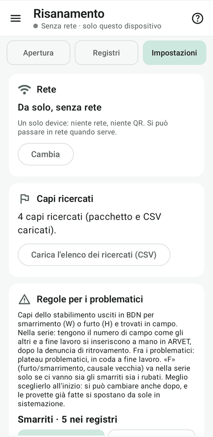
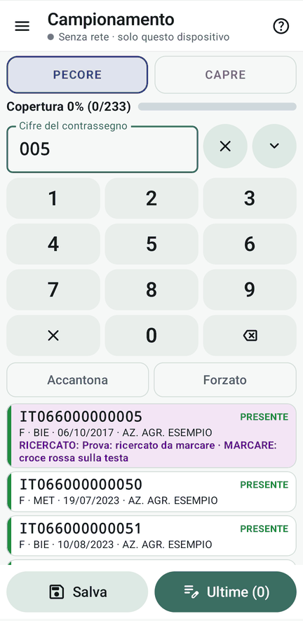
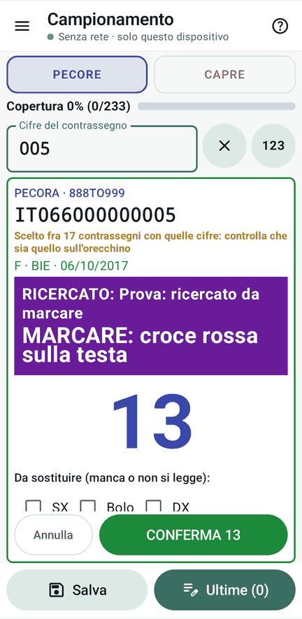

# 5 · I ricercati

**Obiettivo**: i capi ricercati si riconoscono già nella ricerca, su tutti i device.

**Ti serve**: il tablet della Regia, `kit_prova/ricercati_888TO999.csv`.

Un **capo ricercato** è un animale per cui vuoi mostrare una segnalazione quando viene incontrato: per esempio marcarlo, isolarlo o controllare un’anomalia. Non è l’elenco dei capi mancanti al campionamento e il motivo può essere indipendente dalla profilassi.

## Aggiungi un capo durante il lavoro

Dalla Regia apri **Dati › Capi ricercati › Aggiungi capo**. Cerca nei registri e nei contrassegni con le ultime cifre, oppure scrivi a mano il codice completo. Indica il motivo e l’azione richiesta, poi salva. Attendi l’allineamento dei palmari: quelli scollegati riceveranno la segnalazione quando rientrano.

## Importa un elenco

1. Dati › **Capi ricercati** › Importa CSV: carica `ricercati_888TO999.csv`. Se hai creato il progetto
   dal pacchetto, ci sono già.
2. Il CSV ha quattro capi (`codice;nota;azione;segno`):

| Codice | Nota | Azione |
|---|---|---|
| IT066000000005 | ricercato da marcare | marcare: croce rossa sulla testa |
| IT066000000017 | ricercato da isolare | isolare |
| 380066000000222 | per codice elettronico (montone) | marcare: punto blu sul dorso |
| IT066000000703 | in nessun registro | marcare: croce rossa |

<figure markdown="span">
  
  <figcaption>I ricercati caricati</figcaption>
</figure>

<figure markdown="span">
  
  <figcaption>005 nella ricerca, in viola</figcaption>
</figure>

<figure markdown="span">
  
  <figcaption>Il foglio di conferma: cosa fare</figcaption>
</figure>

!!! atteso "Cosa devi vedere"
    Su un palmare, nel Campionamento, digita **005**: il capo compare **in viola**, con la nota e cosa fare, e il
    telefono vibra. Sulle schede, i ricercati hanno il bordo viola. Il montone 222 si riconosce anche dal codice
    elettronico (`380…` e `IT…` con le stesse 12 cifre sono lo stesso capo).

!!! info "Elenco arrivato tardi"
    Se un capo ricercato era già stato prelevato prima che arrivasse l'elenco, chi l'ha prelevato (e la Regia) riceve
    una finestra che resta fino a «Visto».

## Fatto?

- [ ] ricercati caricati, banner viola su 005
