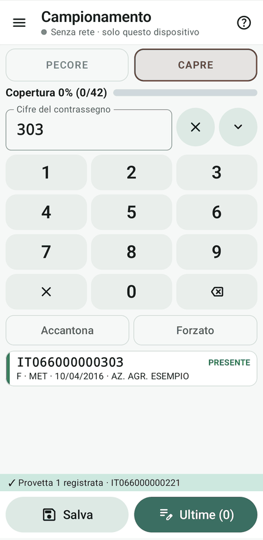
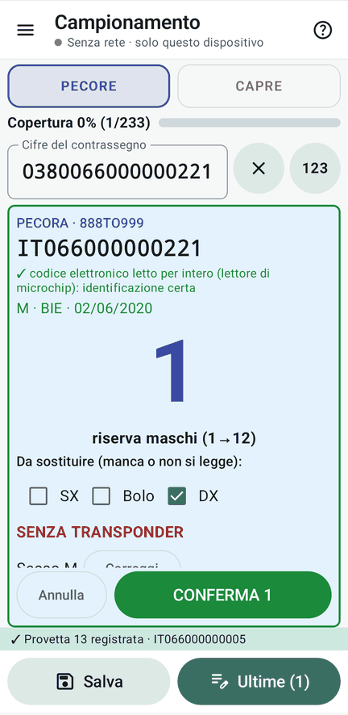
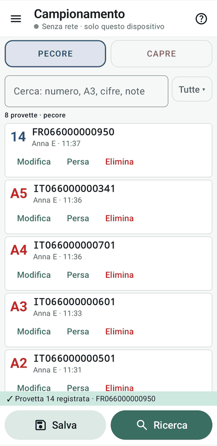

# 6 · Il primo prelievo

**Obiettivo**: registrare le provette dei capi presenti, col tastierino e col lettore, e capire i numeri.

**Ti serve**: i palmari, le schede «Presenti · pecore», «Presenti · montoni», «Presenti · capre»; per le provette,
basta scrivere il numero sulla scheda (o su un foglio).

## Fai

1. Menu ☰ › **Campionamento**, pagina **Pecore**.
2. **Col tastierino**: digita le ultime cifre in grassetto della scheda, per esempio **001**. Compaiono i capi che
   finiscono con quelle cifre, poi quelli che le contengono. Tocca quello giusto.
3. **Col lettore**: leggi il barcode della scheda. Il codice entra da solo e, se il capo è uno solo, **Invio** lo
   sceglie.
4. Nel **foglio di conferma**: in alto, grande, il **numero** da scrivere sulla provetta all'interno del riquadro colorato (neutro = solo l'etichetta; blu = ordinario da isolato, non scrivere tutto; rosso = problematico, contrassegno COMPLETO). Prova le caselle **DX**, **SX** e **bolo** su qualche capo (da sostituire: DX o bolo = senza transponder, in rosso).
5. **«CONFERMA»** (oppure premi **Invio/OK** sulla tastiera/telecomando: conferma col focus su Conferma; se il focus è su un’opzione, attiva quell’opzione) e scrivi il numero sulla provetta.
6. Prova il **cambio di specie**: se digiti o leggi un codice e cambi specie (scorrendo o con le frecce), il codice non si perde e la ricerca riparte da sola.
7. Ripeti con un **montone** (sezione «Presenti · montoni») e con una **capra** (pagina Capre in alto, o scorrendo di
lato).

<figure markdown="span">
  
  <figcaption>Col tastierino: le ultime cifre</figcaption>
</figure>

<figure markdown="span">
  
  <figcaption>Col lettore: identificazione certa; riserva maschi; DX da sostituire</figcaption>
</figure>

<figure markdown="span">
  
  <figcaption>Ultime: modifica, persa, elimina</figcaption>
</figure>

!!! atteso "Cosa devi vedere"
    - I capi presenti in età diagnostica hanno il **numero assegnato fin dal caricamento**:
        - I **montoni** (maschi ovini) prendono i primi numeri (da 1 a 12 nel kit, in ordine alfabetico di contrassegno).
        - Le **pecore** proseguono dal numero 13 in poi.
        - Le **capre** prendono la loro serie con la lettera di specie (es. `C1`, `C2`… se impostata `C` sulla specie meno numerosa).
    - L'etichetta da scrivere sulla provetta compare grande in testa al foglio di conferma:
        - **Riquadro neutro**: provetta ordinaria in rete (copia l’etichetta mostrata);
        - **Riquadro blu**: ordinario prelevato **da isolato** (senza tutti i colleghi collegati, copia l’etichetta completa del suffisso): l'istruzione ricorda *«non scrivere tutto: solo l'etichetta»*; al tavolo la Regia la posiziona subito al pozzetto del suo numero;
        - **Riquadro rosso**: capi **problematici** (fuori età diagnostica, marche nuove, altri stabilimenti, forzati): prendono il codice problematico mostrato e l'istruzione ricorda *«scrivi sempre il contrassegno COMPLETO»*.
    - Per capi senza marche a fine risanamento c'è il tasto **«Senza contrassegno»**, che attribuisce un capo compatibile non prelevato.
    - La provetta si vede salvata (**✓**) solo quando è sul disco; in cima a Campionamento, **Ultime** la mostra.
    - Il foglio dice come è stato identificato il capo: col lettore (codice intero) è certo, con le cifre digitate
      dice fra quanti capi hai scelto.

!!! info "Il numero è definitivo"
    Un numero mostrato non cambia più. Ogni capo ha già il suo numero assegnato nel registro; se un collega registra
    lo stesso capo mentre il tuo foglio è aperto, compare **«Controlla subito il capo»** prima che tu possa confermare.
    Se due palmari confermano insieme lo stesso capo, a tutti e due arriva la **rinomina obbligatoria**, con la
    provetta ancora in mano.

??? failure "Se non va"
    - **L’etichetta ha un suffisso da isolato**: sei da isolato (doppi non controllati). La provetta tiene quel numero e la Regia la verifica al rientro.
    - **Il riquadro è rosso**: il capo non era prenumerato (es. fuori età o marca nuova); andrà risolto in rifinitura.
    - **Il capo sbagliato**: in Ultime, Modifica o Elimina (un nuovo evento: niente si cancella davvero).

## Fatto?

- [ ] provette registrate col tastierino e col lettore
- [ ] un montone e una capra
- [ ] per la prova completa: tutte le schede dei presenti, divise fra i palmari
