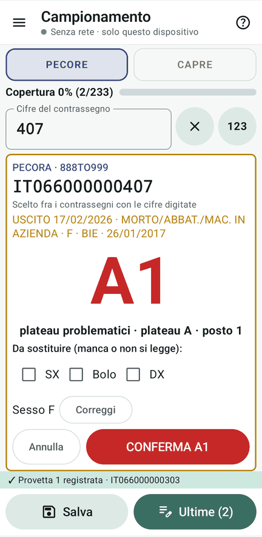
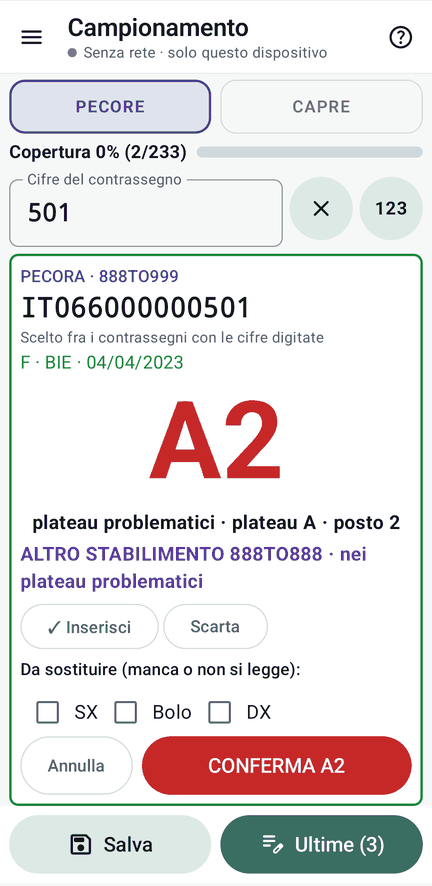
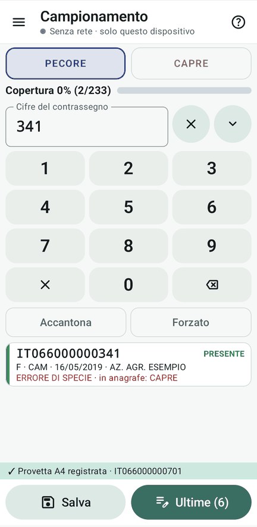
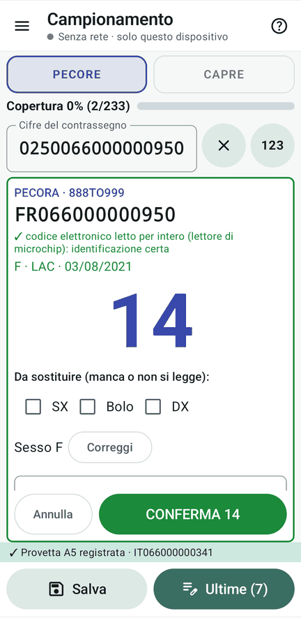
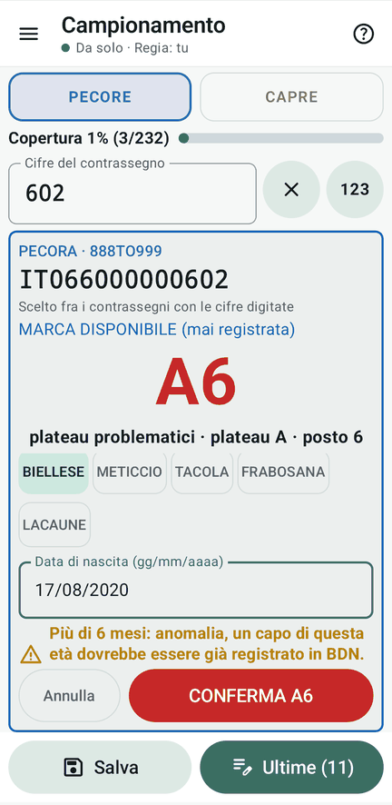
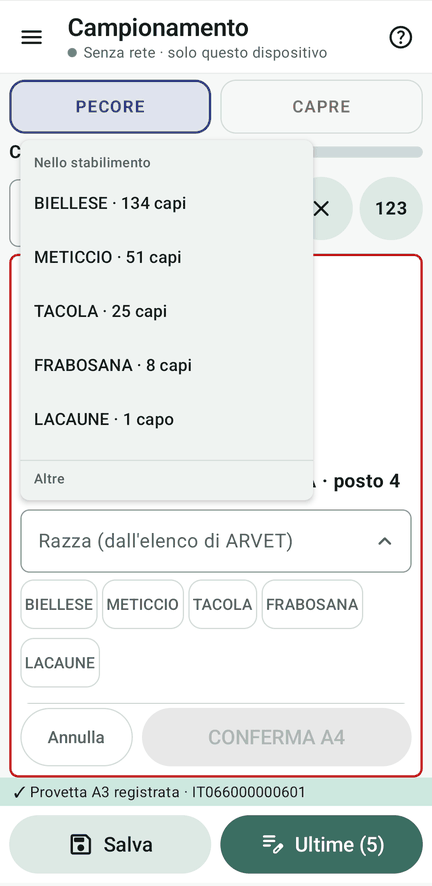
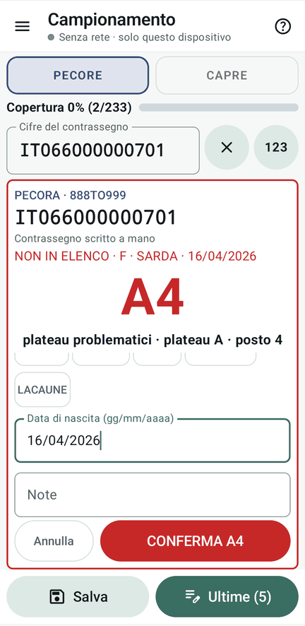

# 7 · Le fattispecie

**Obiettivo**: vedere che cosa fa Fejalog con ogni capo che non è un semplice presente.

**Ti serve**: i palmari e le schede del kit a cinque stabilimenti: presenti, giovani, usciti, DDA e casi particolari. Ogni sezione delle schede ha in testa **«Cosa deve succedere»**. La [tabella delle prove](../kit.md#quali-anomalie-provare) indica quali schede scegliere.

!!! warning "Tre differenze da verificare"
    **Smarrito o rubato ritrovato** resta fuori registro; **marca disponibile** e **contrassegno in nessun registro** richiedono entrambi l'anagrafica ma sono casi diversi; **registro di altro stabilimento caricato** non significa stabilimento campionato. Leggi [tutte le anomalie e le soluzioni](../anomalie.md) prima della prova.

## Fai

Preleva almeno una scheda per sezione e confronta con la tabella.

| Sezione delle schede | Che cosa fare | Cosa devi vedere |
|---|---|---|
| Usciti · smarriti e rubati (W, H, F) | come un presente | avviso **USCITO** (giallo): sempre fra i fuori registro (codice del veterinario) |
| Usciti · morti (D, N, Q, Y, Y3, 2, 3, 4, 5, 6) | verifica il codice (incluso `Y3` presunto morto, letto su due colonne) anche se sul campo è vivo | **USCITO**: fra i fuori registro, con l'etichetta mostrata |
| Usciti · trasferiti (V, E, G, I, J, K, P, R, S, T, U) | come un presente | **USCITO**: fra i fuori registro |
| Usciti · macello (M, A) | come un presente | **USCITO**: fra i fuori registro |
| Usciti · altre causali (C, L, X, Z, 8, 9) | come un presente | **USCITO**: fra i fuori registro |
| Altro stabilimento (888TO222, di riferimento) | verifica la destinazione; prova «Scarta», poi ripeti scegliendo «Inserisci» e conferma | **ALTRO STABILIMENTO 888TO222**, avviso viola; scartare non registra un prelievo, inserire produce una provetta fuori registro |
| Marche disponibili | cerca una marca dalla sezione dedicata | il contrassegno non è registrato su un capo: **sesso, razza e data di nascita obbligatori**, fra i fuori registro |
| In nessun registro | non si trova: **«Forzato»**, sotto il tastierino, col contrassegno intero | **sesso, razza e data di nascita obbligatori**, fra i fuori registro |
| Specie discordante | cerca queste **capre** nella pagina **Pecore** | **ERRORE DI SPECIE**: verificare il capo |
| Codice elettronico estero | leggi il barcode (`0250…`) | Fejalog lo riconosce come **FR066000010030** |

**Non cambiare etichetta in base a un esempio stampato:** copia quella del foglio di conferma, incluso il contrassegno completo nel riquadro rosso. Le immagini qui sotto sono di una versione precedente; la forma delle etichette dipende dal progetto.

### Altri stabilimenti: tre prove diverse

1. **Solo riferimento**: `888TO222` non è campionato. Il capo `IT066000014219` è fuori registro anche se risulta presente nel proprio registro.
2. **Acquisto individuale**: nella [lezione 9](09-registri-in-corsa.md), carica il registro in corsa di `888TO222` come riferimento e dichiara il DDA su `IT066000014241`. La provetta resta da verificare; il capo successivo non deve ereditare la spunta.
3. **Altro risanamento contemporaneo**: nel kit a cinque stabilimenti `888TO888` è già di lavoro, quindi i suoi adulti presenti sono ordinari nella propria serie. `888TO222` resta invece di riferimento: prova un capo prima e uno dopo l'aggiunta come secondario da parte della Regia. I numeri già scritti restano invariati.

Nel kit avanzato controlla anche i capi **solo usciti dagli stabilimenti chiusi** `888TO444` e `888TO333`: vanno chiariti come altro stabilimento. Se lo stesso codice risulta già presente in uno stabilimento di lavoro, la vecchia uscita è soltanto storia: verifica che prevalga il presente.

### Fuori età e identificazione incompleta

- **Fuori età diagnostica**: usa il kit a cinque stabilimenti con soglia **12 mesi** e data della seduta **24/10/2026**. Scegli `IT066000010012`, nato il 19/11/2025, dalla sezione giovani fra 6 e 12 mesi. Se lo prelevi, è fuori registro senza numero ordinario; alla fine la Regia sceglie se inserirlo in coda o eliminarlo (nessuna scelta predefinita). Anche i giovani sotto sei mesi vanno provati. Le età delle schede sono riferite alla data del kit.
- **Senza contrassegno**: simula un animale senza marche e usa il tasto omonimo, con sesso, denti, razza e la sigla della provetta come identificazione provvisoria. In campo non si sceglie nessun capo: dopo la chiusura, nel Banco del sito, la proposta è il capo assente più simile o una marca disponibile.
- **Orecchino o bolo illeggibile**: su un'ordinaria prova DX, SX e bolo da sostituire. DX o bolo segnalati compaiono fra i senza transponder; la segnalazione non basta a trasformarla in fuori registro.
- **Sesso discordante**: su una scheda presente verifica il comando di correzione del sesso e la nota in Ultime; controlla il dato nelle uscite finali.

<figure markdown="span">
  
  <figcaption>Uscito (morto): A1, plateau fuori registro</figcaption>
</figure>

<figure markdown="span">
  
  <figcaption>Altro stabilimento: Inserisci o Scarta</figcaption>
</figure>

<figure markdown="span">
  
  <figcaption>Una capra cercata fra le pecore</figcaption>
</figure>

<figure markdown="span">
  
  <figcaption>Codice estero dal lettore</figcaption>
</figure>

!!! atteso "L'anagrafica scritta in campo"
    Per marche disponibili e capi in nessun registro, la **razza si sceglie dall'elenco delle razze di ARVET**. In
    testa ci sono quelle del gregge, dalla più numerosa (BIELLESE, METICCIO…), poi le altre in ordine alfabetico; una
    razza fuori elenco non si conferma. Una **nascita di più di 6 mesi** prima è un'anomalia: il foglio la segnala in
    giallo, senza bloccare.

<figure markdown="span">
  
  <figcaption>Marca disponibile: razza del gregge; nascita oltre 6 mesi in giallo</figcaption>
</figure>

<figure markdown="span">
  
  <figcaption>Le razze del gregge, poi le altre di ARVET</figcaption>
</figure>

<figure markdown="span">
  
  <figcaption>Forzato: contrassegno scritto a mano, anagrafica</figcaption>
</figure>

!!! info "Fuori registro e lettere"
    I fuori registro prendono il **codice fuori registro mostrato** con riquadro rosso e istruzione *«scrivi sempre il contrassegno COMPLETO»*, e vanno nel **secchio** (nei progetti pregressi resta il plateau fuori registro). La Regia li decide uno alla volta nel Banco: in coda, a un capo, eliminata la singola provetta, persa o rimandata. Le eliminate non hanno numero finale né invio ARVET; per i fuori età la Regia sceglie alla fine, senza predefinito.

### Completa il controllo nelle altre lezioni

I [ricercati](05-ricercati.md) possono accompagnare qualunque categoria. Prova anche [doppi e collisioni al rientro in rete](08-doppi-rete.md), [riclassificazioni coi registri nuovi](09-registri-in-corsa.md), [perse e ritrovate](10-statistiche.md), [accantonate, non trovati e tardive](11-problemi.md). Un'ordinaria da isolato e un codice estero riconosciuto non sono, da soli, anomalie anagrafiche.

## Fatto?

- [ ] almeno una scheda per sezione, ognuna col suo avviso
- [ ] un inserimento forzato con l'anagrafica
- [ ] la specie discordante e il codice estero
- [ ] riferimento, DDA individuale e secondario di lavoro distinti
- [ ] fuori età con soluzione predefinita Eliminata
- [ ] senza contrassegno, DX/SX/bolo e sesso corretto
- [ ] verifica delle soluzioni a fine lavori, senza inviare automaticamente tutte le provette fuori registro
