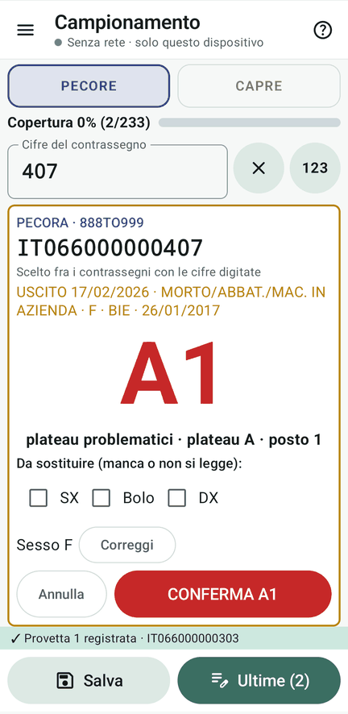
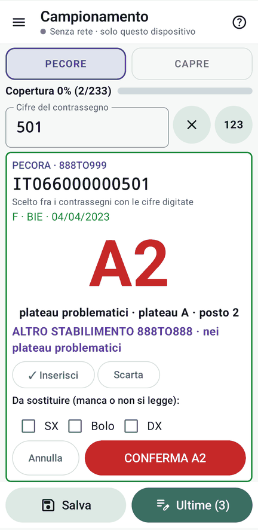
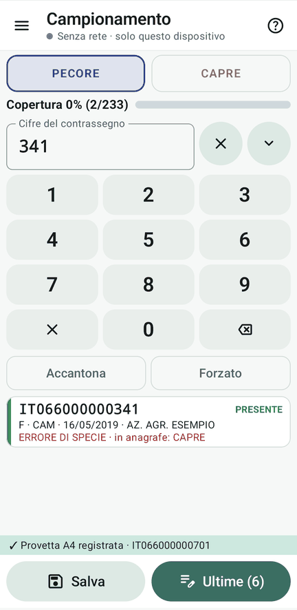
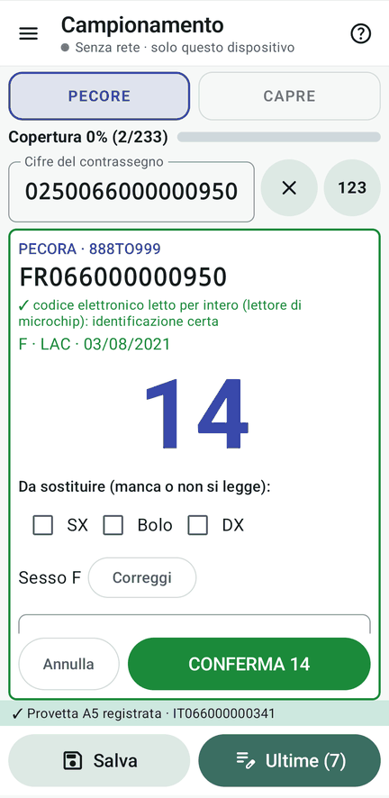
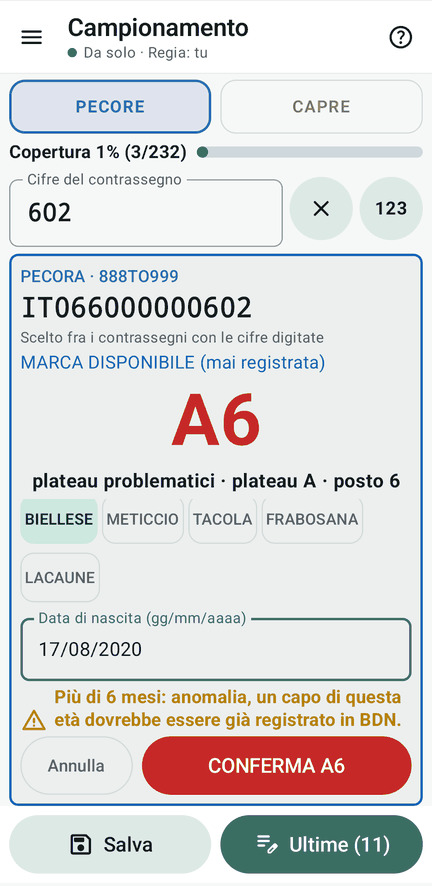
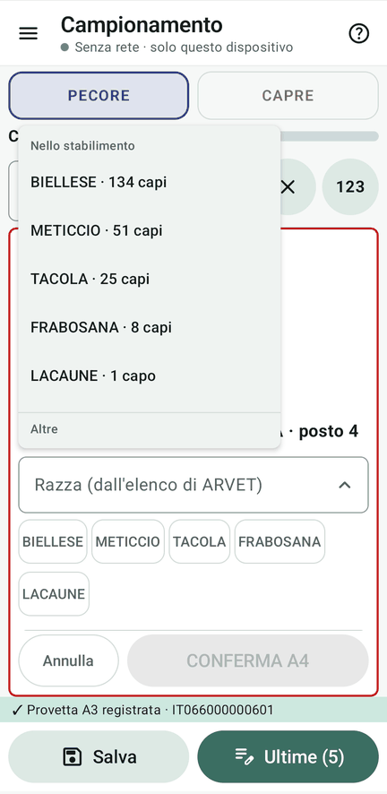
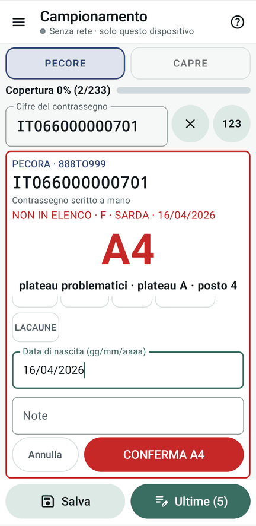

# 7 · Le fattispecie

**Obiettivo**: vedere che cosa fa Fejalog con ogni capo che non è un semplice presente.

**Ti serve**: i palmari e le schede dalle sezioni «Usciti» in poi. Ogni sezione delle schede ha in testa **«Cosa deve
succedere»**.

## Fai

Preleva almeno una scheda per sezione e confronta con la tabella.

| Sezione delle schede | Che cosa fare | Cosa devi vedere |
|---|---|---|
| Usciti · smarriti e rubati (W, H, F) | come un presente | avviso **USCITO** (giallo). Con le regole predefinite W va nella serie, H fra i problematici, F nella serie solo se lo sono tutti e due |
| Usciti · morti (D, N, Q, Y) | come un presente | **USCITO**: fra i problematici (codice operatore CA1, CA2…) |
| Usciti · trasferiti (V, E, G, I, J, K, P, R, S, T, U) | come un presente | **USCITO**: fra i problematici |
| Usciti · macello (M, A) | come un presente | **USCITO**: fra i problematici |
| Usciti · altre causali (C, L, X, Z) | come un presente | **USCITO**: fra i problematici |
| Altro stabilimento (888TO888) | come un presente | **ALTRO STABILIMENTO 888TO888**: «Inserisci» (plateau problematici) o «Scarta» |
| Marche disponibili | come un presente | la marca non è mai stata messa su un capo: **sesso, razza e data di nascita obbligatori** |
| In nessun registro | non si trova: **«Forzato»**, sotto il tastierino, col contrassegno intero | **sesso, razza e data di nascita obbligatori**, fra i problematici |
| Specie discordante | cerca queste **capre** nella pagina **Pecore** | **ERRORE DI SPECIE**: verificare il capo |
| Codice elettronico estero | leggi il barcode (`0250…`) | Fejalog lo riconosce come **FR066000000950** |

<figure markdown="span">
  
  <figcaption>Uscito (morto): A1, plateau problematici</figcaption>
</figure>

<figure markdown="span">
  
  <figcaption>Altro stabilimento: Inserisci o Scarta</figcaption>
</figure>

<figure markdown="span">
  
  <figcaption>Una capra cercata fra le pecore</figcaption>
</figure>

<figure markdown="span">
  
  <figcaption>Codice estero dal lettore</figcaption>
</figure>

!!! atteso "L'anagrafica scritta in campo"
    Per marche disponibili e capi in nessun registro, la **razza si sceglie dall'elenco delle razze di ARVET**. In
    testa ci sono quelle del gregge, dalla più numerosa (BIELLESE, METICCIO…), poi le altre in ordine alfabetico; una
    razza fuori elenco non si conferma. Una **nascita di più di 6 mesi** prima è un'anomalia: il foglio la segnala in
    giallo, senza bloccare.

<figure markdown="span">
  
  <figcaption>Marca disponibile: razza del gregge; nascita oltre 6 mesi in giallo</figcaption>
</figure>

<figure markdown="span">
  
  <figcaption>Le razze del gregge, poi le altre di ARVET</figcaption>
</figure>

<figure markdown="span">
  
  <figcaption>Forzato: contrassegno scritto a mano, anagrafica</figcaption>
</figure>

!!! info "Problematici e lettere"
    I problematici prendono la **lettera di chi li preleva** (A1, A2…) e vanno nei **plateau problematici**. A fine
    lavoro la sistemazione li porta in coda alla serie, col numero finale.

## Fatto?

- [ ] almeno una scheda per sezione, ognuna col suo avviso
- [ ] un inserimento forzato con l'anagrafica
- [ ] la specie discordante e il codice estero
