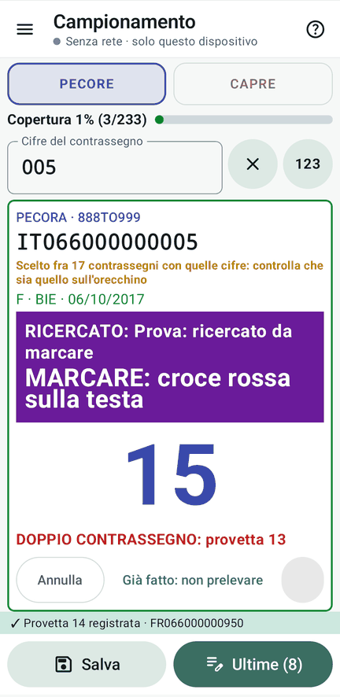

# 8 · Doppi e rete difficile

**Obiettivo**: vedere i doppi di contrassegno in tempo reale, e lavorare quando la rete manca.

**Ti serve**: almeno due palmari in rete, e la sezione «Doppi di contrassegno (seconda lettura)» delle schede: tre capi
già nel gregge.

## Fai

1. **Doppio in rete.** Un palmare preleva il capo IT066000000003; un **altro** palmare
   legge la seconda scheda dello stesso capo.
2. **Senza rete.** Su un palmare spegni la Wi-Fi e continua a prelevare. Poi leggi su quel palmare un capo che un altro
   ha già fatto (per esempio 150). Riaccendi la Wi-Fi.
3. **Regia spenta.** Spegni la Wi-Fi del tablet (o il tablet) e continua sui palmari. Dopo 2 minuti, su un palmare:
   Rete › **«Prendi la regia»**. Riaccendi il tablet.

<figure markdown="span">
  
  <figcaption>Lo stesso capo una seconda volta (qui sullo stesso device)</figcaption>
</figure>

!!! atteso "Cosa devi vedere"
    - **In rete**: il secondo palmare vede **«DOPPIO CONTRASSEGNO: provetta N prelevata da … alle …»** e sceglie
      «Già fatto: non prelevare» (niente registrato) o «Preleva come doppio contrassegno» (fra i problematici).
    - **Senza rete**: in alto la banda **gialla** (numeri ancora pronti), poi **rossa** con le **provvisorie A•1**,
      sempre con «**Doppi NON controllati**». Riaccesa la Wi-Fi, i doppi scoperti aprono ai due operatori una
      finestra che resta fino a «**Visto**»; la seconda provetta va fra i problematici.
    - **Regia spenta**: i palmari continuano coi loro numeri; la regia si prende quando è libera. Le **impronte** del
      registro tornano uguali su tutti i device.

??? failure "Se non va"
    - **Il telefono vibra**: è giusto, vibra quando lo stato della rete peggiora.
    - **«Prendi la regia» non c'è**: la regia non è ancora libera (2 minuti senza risposta, o chi ce l'ha la deve
      lasciare).

## Fatto?

- [ ] doppio visto in rete
- [ ] provvisorie fuori rete e doppio scoperto al ritorno
- [ ] regia presa da un palmare, impronte uguali
