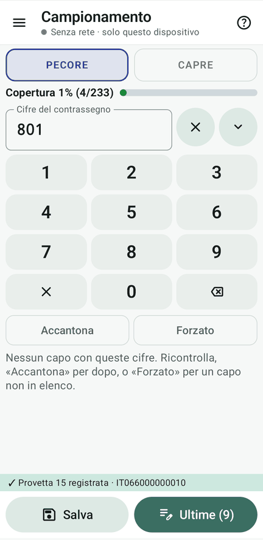
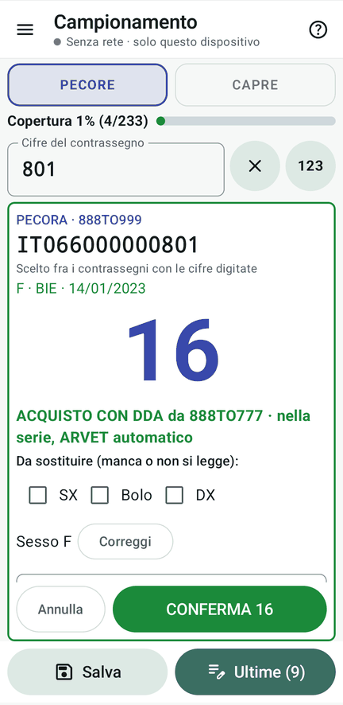
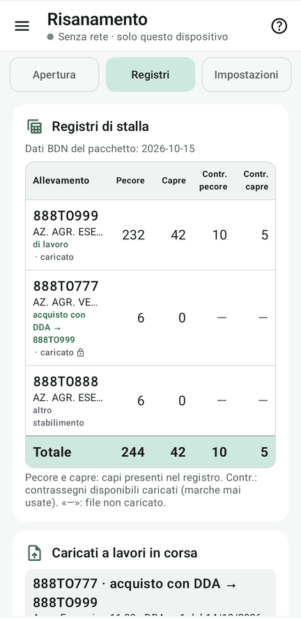
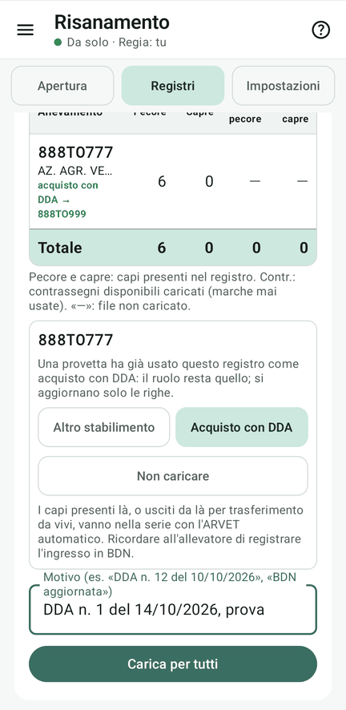

# 9 · Registri in corsa

**Obiettivo**: caricare registri nuovi a lavoro iniziato: un **acquisto con DDA** e il registro **aggiornato** dello
stabilimento.

**Ti serve**: il tablet della Regia, i file di `kit_prova/in_corsa/`; le schede «Acquisto con DDA».

## Fai

1. **Prima** del caricamento, un palmare cerca una scheda «Acquisto con DDA» (per esempio
   801): non si trova, è in nessun registro.
2. Regia: Risanamento › **Registri** › «Scegli i file (anche uno zip)» › `in_corsa/888TO777_pecore_….txt`. Per
   888TO777 scegli **Acquisto con DDA** e scrivi il motivo («DDA n. 1 del 14/10/2026, prova»). **«Carica per tutti»**.
3. Ora preleva le schede «Acquisto con DDA».
4. Regia: «Scegli i file» › `in_corsa/888TO999_pecore_…_1100.txt`: è il registro aggiornato dello **stabilimento di
   lavoro**, che **sostituisce** quello di prima: «Sostituisci», motivo «BDN aggiornata», «Carica per tutti».

<figure markdown="span">
  
  <figcaption>Prima del caricamento 801 non si trova</figcaption>
</figure>

<figure markdown="span">
  
  <figcaption>Dopo: acquisto con DDA, nella serie</figcaption>
</figure>

<figure markdown="span">
  
  <figcaption>La tabella coi registri caricati</figcaption>
</figure>

!!! atteso "Cosa devi vedere"
    - I capi del venditore vanno **nella serie**, con l'ARVET automatico; nelle cose da fare per l'allevatore c'è da
      registrare l'ingresso in BDN.
    - Nel registro aggiornato **IT066000000010** risulta **venduto** (V). Se era già stato prelevato, la provetta
      resta al suo numero e in sistemazione va **in coda**; il capo ora è un problematico.
    - Il registro aggiornato è delle sole **pecore**: le **capre** di 888TO999 restano quelle di prima (42).
    - Risanamento › Registri: la tabella ha anche 888TO777, «acquisto con DDA → 888TO999».

!!! info "Il ruolo di un registro"
    Un registro di un altro stabilimento si ritira finché nessuna provetta l'ha usato; poi il suo ruolo non cambia più.

<figure markdown="span">
  
  <figcaption>Ricaricato dopo una provetta: il ruolo resta</figcaption>
</figure>

## Fatto?

- [ ] DDA caricato e capi del venditore nella serie
- [ ] registro aggiornato: …010 venduto
