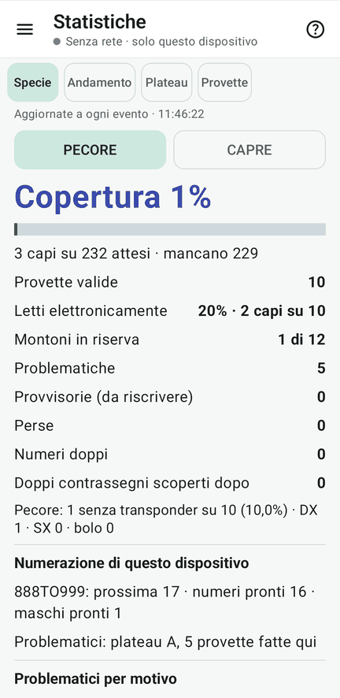
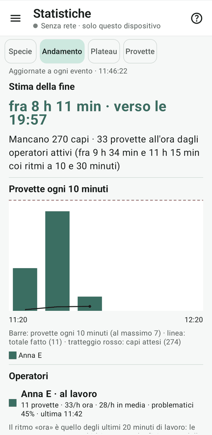
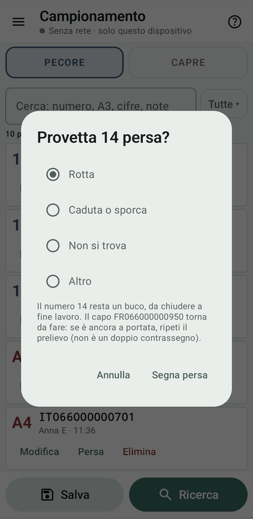
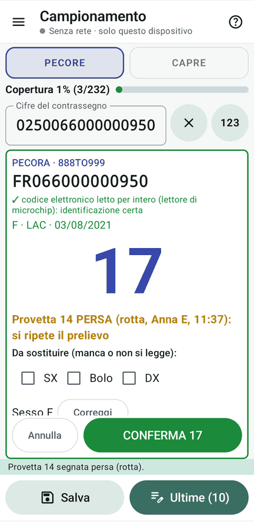

# 10 · Statistiche e provette perse

**Obiettivo**: seguire il lavoro e gestire una provetta rotta.

**Ti serve**: qualunque device.

## Fai

1. Menu ☰ › **Statistiche**: copertura per specie (fatti, attesi, mancanti), letti elettronicamente, andamento del
   lavoro per operatore con la stima della fine, problematici per motivo.
2. **Plateau**: un plateau alla volta, con le coordinate; i plateau con buchi o perse hanno il bordo rosso.
3. **Provette**: l'elenco in parole, con ricerca e filtri.
4. **Una provetta rotta**: Campionamento › **Ultime** › una provetta › **«Persa»**, motivo «Rotta», «Segna persa».
   Poi preleva di nuovo lo stesso capo.

<figure markdown="span">
  
  <figcaption>Specie: copertura e conteggi</figcaption>
</figure>

<figure markdown="span">
  
  <figcaption>Andamento: stima della fine e ritmi</figcaption>
</figure>

<figure markdown="span">
  
  <figcaption>Plateau: maschi in testa, i numeri che arriveranno</figcaption>
</figure>

<figure markdown="span">
  
  <figcaption>Provetta persa: il motivo</figcaption>
</figure>

<figure markdown="span">
  
  <figcaption>Lo stesso capo di nuovo: non è un doppio</figcaption>
</figure>

!!! atteso "Cosa devi vedere"
    - La provetta persa **tiene il suo numero**, che diventa un **buco** da chiudere a fine lavoro.
    - Il capo torna da fare: il foglio dice «Provetta N **PERSA** (rotta): si ripete il prelievo», e **non** è un
      doppio contrassegno.
    - Toccando un capo mancante in Statistiche, lo si cerca nel Campionamento.

## Fatto?

- [ ] copertura e andamento visti
- [ ] una provetta persa e il prelievo ripetuto
