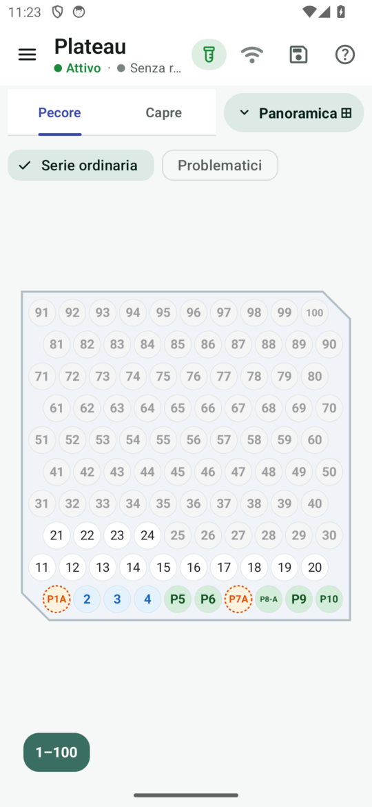

# 10 bis · Il Plateau della Regia

**Obiettivo**: ricevere le provette dai palmari e metterle nei pozzetti giusti, senza spostarle fino al riordino.

**Ti serve**: il tablet della Regia, durante il campionamento; le provette (o le schede) consegnate dai palmari.

## Fai

1. Menu ☰ › **Campionamento › Plateau**. In alto la specie e la vista: **Serie ordinaria** o **Problematici**.
2. Nel riquadro delle consegne, accanto a ogni veterinario, tocca **«Ricevi (N)»** e conferma: hai in mano le sue
   provette. Lo stesso vale se è il palmare a toccare «Conferma consegna».
3. Metti ogni provetta dove dice lo schema: le ordinarie e le provette da isolato non doppie al pozzetto del loro numero; le problematiche e le doppie nei pozzetti della vista Problematici (in sequenza unica per l'intero progetto, nel verso di riempimento scelto).
4. Con **Cerca** (numero, etichetta o cifre del contrassegno) lo schema va al plateau giusto e il pozzetto lampeggia.

<figure markdown="span">
  
  <figcaption>Serie ordinaria: i numeri nei pozzetti</figcaption>
</figure>

<figure markdown="span">
  
  <figcaption>Immagine precedente: mostra le righe per veterinario dei progetti pregressi, non la sequenza unica dei progetti nuovi.</figcaption>
</figure>

!!! atteso "Cosa devi vedere"
    - Le provette ricevute passano da colore **pastello** a colore **pieno**.
    - Gli **isolati non doppi** vanno subito al pozzetto del loro numero ordinario.
    - I **problematici** riempiono i plateau in sequenza unica per l'intero progetto in ordine di consegna, secondo il verso stabilito (alto→basso o basso→alto).
    - Ogni provetta ha **un solo pozzetto**, e il posto registrato alla consegna **non cambia più** fino al riordino.

!!! info "A campionamento aperto si riempie soltanto"
    Il posto di una provetta si decide quando la Regia la riceve e poi **non cambia più**: né per una rinomina, né
    per un doppio scoperto dopo, né per una nota. Una provetta annullata o persa lascia vuoto il suo pozzetto. Gli
    spostamenti si fanno tutti nel [riordino](12-riordino.md), a campionamento chiuso.

## Dopo la chiusura del campionamento

Da **Gestione campioni › Plateau**, la vista segue la posa registrata e gli invii applicati del Riordino. Scegli stabilimento, specie e vista. Cerca cifre finali, contrassegno intero o etichetta e tocca un risultato: centra ed evidenzia il pozzetto e apre la scheda della provetta, con il contrassegno copiabile.

Per cercare una posizione scrivi **plateau / pozzetto**, per esempio plateau **2**, pozzetto **25**, nella serie e vista scelte: funziona anche sui posti vuoti. I problematici in sequenza unica mostrano insieme specie e stabilimenti. I colori distinguono ordinarie, da isolato, problematiche, provvisorie, annullate e perse; queste ultime due sono riferimenti all’ultimo posto noto e non occupano il pozzetto. Se manca la posa registrata il posto è indicativo.

I plateau sono affiancati: usa **− / Ripristina / +**, oppure pizzico e trascinamento sul tablet, rotella e trascinamento sul PC. Sul computer puoi staccare la finestra: dati, ricerca, selezione e zoom restano condivisi, anche mentre lavori nel Riordino. Vale sia via USB sia sul sito aperto da uno zip; le azioni locali restano nel file da riportare nell’app.

## Fatto?

- [ ] provette di almeno due veterinari ricevute
- [ ] un isolato non doppio al proprio numero nella serie ordinaria
- [ ] una provetta trovata con Cerca

Nei progetti nuovi il verso predefinito è alto→basso e i problematici seguono una sequenza unica. I progetti già avviati conservano la disposizione precedente; senza il parametro del verso resta basso→alto.
