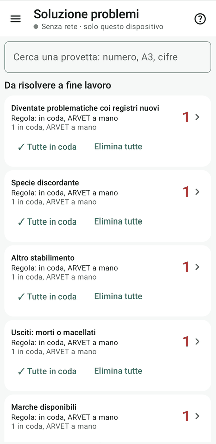

# 11 · Soluzione problemi

**Obiettivo**: decidere che cosa fare dei problematici prima della sistemazione.

**Ti serve**: il tablet della Regia, a campionamento chiuso, dopo aver prelevato le fattispecie della [lezione 7](07-fattispecie.md). Tieni accanto il [quadro delle anomalie](../anomalie.md).

## Fai

1. Apri **Lavoro › Problemi da risolvere**: i problematici per tipologia (smarriti, rubati, usciti morti o macellati,
   trasferiti, altro stabilimento, marche disponibili, non in elenco, fuori età, doppi, specie discordante, altre problematiche).
   Controlla anche **Acquisti con DDA**, **Attribuite da riattribuire**, **Diventate problematiche**
   (la …010 della [lezione 9](09-registri-in-corsa.md)) e **Ora in lista coi registri nuovi**.
2. Per ogni tipologia, la **regola**:
    - «Tutte in coda»: col numero finale in coda alla serie; controlla i dati e il trattamento ARVET nelle uscite;
    - «Elimina tutte»: messe da parte, niente numero finale, niente ARVET;
    - «Normalizza tutte»: solo per quelle che ora sono in lista.
3. Apri una tipologia: provetta per provetta si sceglie una soluzione diversa dalla regola, si segna persa o
   ritrovata, si annulla.
4. Guarda **accantonate**, **perse**, **provvisorie** e **ricercati trovati**.

!!! warning "Controlli prima del riordino"
    - **Smarriti e rubati** non diventano ordinari perché ritrovati sul campo. Verifica il caso e gli aggiornamenti anagrafici.
    - **DDA**: il solo documento dichiarato non basta. Verifica valido/da rifare e conferma l'ingresso registrato prima di normalizzare; Fejalog non scrive nella BDN.
    - **Fuori età**: controlla la scelta predefinita **Eliminata**, senza numero finale e senza ARVET.
    - **Altro stabilimento**: un registro di riferimento non equivale a un risanamento in contemporanea. Controlla destinazione e serie.
    - **Doppie e attribuite da verificare**: confronta gli animali e le provette fisiche prima di scegliere quali tenere.

## Accantonate, mancanti e conferme mancate

Un'**accantonata** non è ancora una provetta registrata: usa **Cerca e registra** oppure **Scarta**. Un **presente non prelevato** è invece un capo atteso per il quale non risulta il campione: non registrarlo solo per completare la distinta.

Se hai davvero una provetta fisica non confermata, apri **Non trovati e tardive**, cerca anche usando la parte leggibile dell'etichetta e verifica il candidato. Solo la Regia usa **Attribuisci**, inserisce l'etichetta effettiva e una nota obbligatoria, poi registra senza riaprire il campionamento. La prova completa è negli [incidenti programmati](../provalo/incidenti-programmati.md).

<figure markdown="span">
  
  <figcaption>Le tipologie con la loro regola</figcaption>
</figure>

!!! atteso "Cosa devi vedere"
    Le scelte si vedono su tutti i device, col nome di chi le ha fatte. Le provette eliminate spariscono dalla
    numerazione finale e la guida del riordino le elenca, da mettere da parte.

## Fatto?

- [ ] una regola per ogni tipologia
- [ ] almeno una soluzione per provetta
- [ ] DDA, fuori età, altro stabilimento e attribuite controllati quando presenti
- [ ] accantonate risolte, mancanti verificati e tardive registrate solo con una provetta fisica riconosciuta
