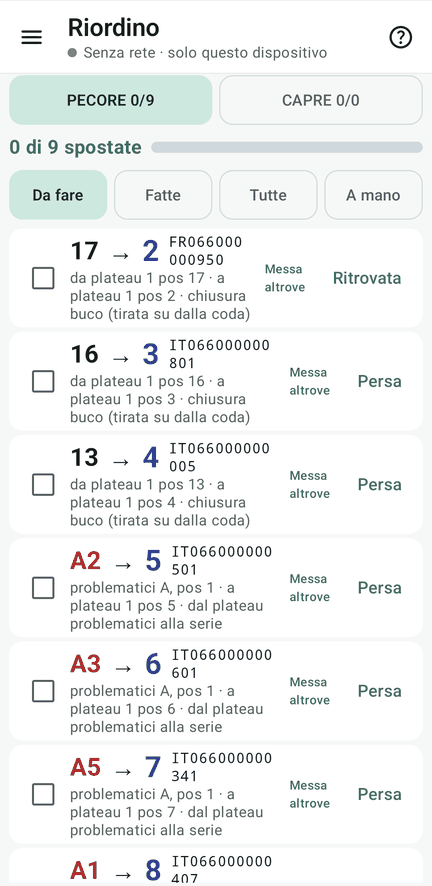
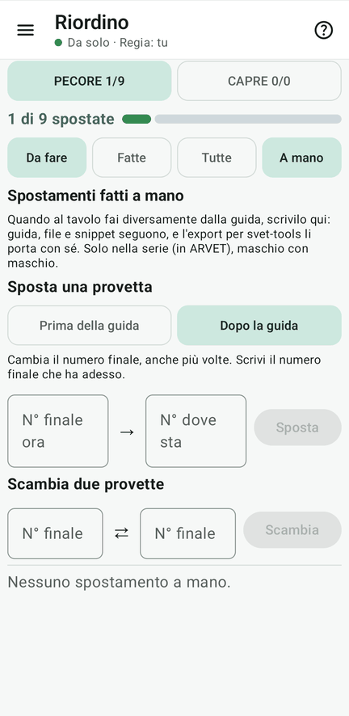

# 12 · Riordino dei plateau

**Obiettivo**: portare ogni provetta al suo numero finale, con la guida a spunta.

**Ti serve**: il tablet della Regia; per la prova, le schede (o i fogli) con i numeri scritti in campo, disposte come
plateau da 100.

## Fai

1. Menu ☰ › **Riordino**: la sistemazione si calcola da sola, col motore di svet-tools. Se il lavoro cambia dopo, una
   banda gialla propone **«Ricalcola»**.
2. Segui la **guida**: ogni provetta va **direttamente al numero finale, una volta sola**. Spunta ogni spostamento
   fatto.
3. Il numero di campo non si cancella e non si copre: si **barra con una riga sola** e si scrive accanto il numero
   finale.
4. Prova **«Messa altrove»** (la provetta non è andata dove diceva la guida) e **«A mano»** («Sposta una provetta» o
   «Scambia due provette»).

<figure markdown="span">
  
  <figcaption>La guida: dal numero di campo al finale</figcaption>
</figure>

<figure markdown="span">
  
  <figcaption>A mano: sposta o scambia</figcaption>
</figure>

!!! atteso "Cosa devi vedere"
    - I **maschi in testa**, poi la serie; i problematici, le provvisorie e i buchi si sistemano; i problematici in coda.
    - Le spunte sono nel registro: le vedono tutti.
    - Gli spostamenti a mano entrano nella guida e nei file di fine lavori.

!!! info "Dal numero di campo si risale sempre al capo"
    Il numero di campo è registrato a parte dal finale: qualunque spostamento ci sia stato, l'abbinamento iniziale fra
    provetta e capo resta ricostruibile.

## Fatto?

- [ ] sistemazione calcolata
- [ ] guida spuntata fino in fondo
