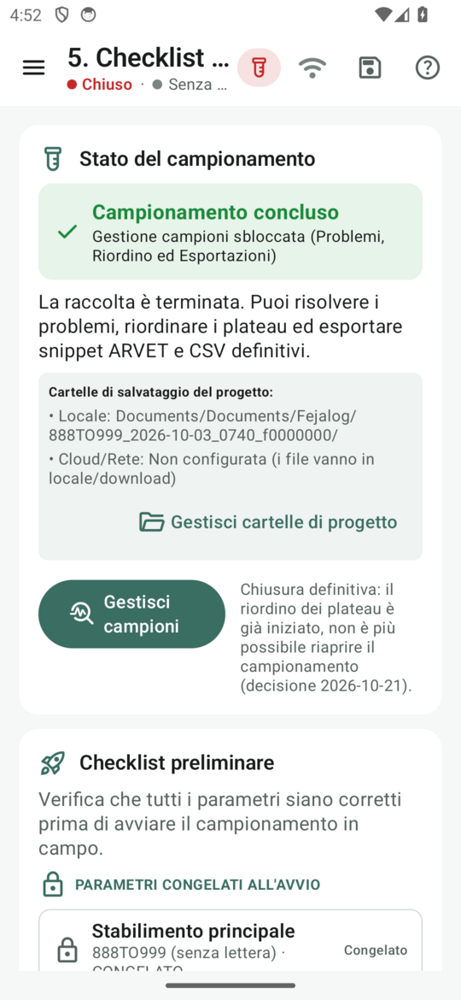

# 12 · Riordino dei plateau

**Obiettivo**: portare ogni provetta al suo numero finale, con invii singoli o selezionati.

**Ti serve**: il tablet della Regia; per la prova, le schede (o i fogli) con i numeri scritti in campo, disposte come
plateau da 100.

## Fai

1. Chiudi il campionamento (**Checklist › Chiudi campionamento**): il riordino si fa solo a campionamento chiuso.
2. Menu ☰ › **Gestione campioni › Riordino plateau**: la sistemazione si calcola da sola, col motore di Fejalog. Se il
   lavoro cambia dopo, la sistemazione si aggiorna; puoi usare anche **«Ricalcola»**.
3. Segui la **guida**: ogni riga dice l'etichetta scritta sulla provetta e **da dove prenderla**, come nel Plateau («Plat. 1 · Pozz. 11 (Problematici)»). Ogni provetta va **direttamente al numero finale, una volta sola**. Ogni riga mostra la fattispecie. Premi **Invia** sulla singola riga, oppure seleziona le righe e premi **Invia le selezionate**.
4. Il numero di campo non si cancella e non si copre: si **barra con una riga sola** e si scrive accanto il numero
   finale.
5. Modifica il campo **A**: la riga è segnata e la casella batch si disabilita. **Ripristina** riporta il suggerimento. Se il numero è occupato lo strumento propone lo scambio: annullando non scrive nulla. Invia le destinazioni modificate con il loro tasto.

!!! info "Immagini della versione precedente"
    Le immagini sotto mostrano ancora la spunta come azione e «Messa altrove». Ora la casella seleziona soltanto; destinazione e invio sono nella riga.

<figure markdown="span">
  
  <figcaption>La guida: dal numero di campo al finale</figcaption>
</figure>

<figure markdown="span">
  
  <figcaption>La guida parte dal pozzetto vero della provetta</figcaption>
</figure>

<figure markdown="span">
  
  <figcaption>Dopo il primo invio applicato il campionamento non si riapre</figcaption>
</figure>

<figure markdown="span">
  
  <figcaption>A mano: sposta o scambia</figcaption>
</figure>

!!! atteso "Cosa devi vedere"
    - I **maschi ovini in testa**, poi la serie delle femmine e le capre.
    - La **chiusura dei buchi** sui prenumerati avviene prima dei problematici, tranne per i maschi ovini che si compattano dopo i problematici maschi.
    - I **problematici** vanno in coda alla rispettiva serie; i codici problematici mostrati e le etichette delle provette da isolato ricevono il numero sequenziale finale.
    - Ogni provetta spostata ha la sua riga nella guida, dal suo pozzetto fisico registrato alla consegna al numero finale.
    - Le azioni applicate sono nel registro: selezionare non equivale a fare. **Dal primo invio applicato il campionamento è chiuso per sempre**: in
      Checklist la riapertura non c'è più.
    - Gli spostamenti a mano entrano nella guida e nei file di fine lavori.

!!! info "Dal numero di campo si risale sempre al capo"
    Il numero di campo è registrato a parte dal finale: qualunque spostamento ci sia stato, l'abbinamento iniziale fra
    provetta e capo resta ricostruibile.

## Fatto?

- [ ] sistemazione calcolata
- [ ] tutte le righe applicate; contatore coerente
- [ ] invio singolo, batch e annullamento di uno scambio provati
