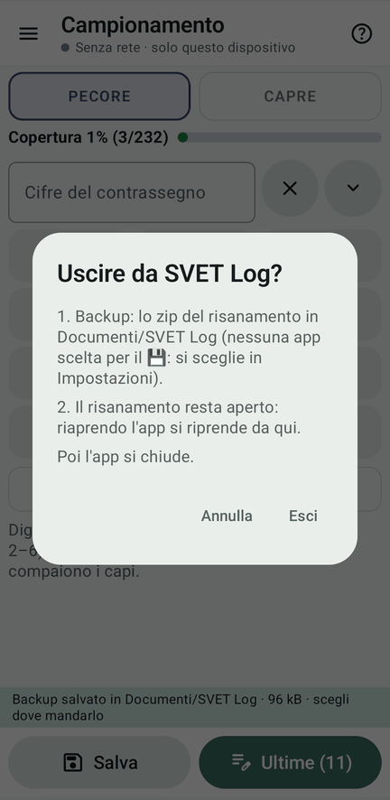
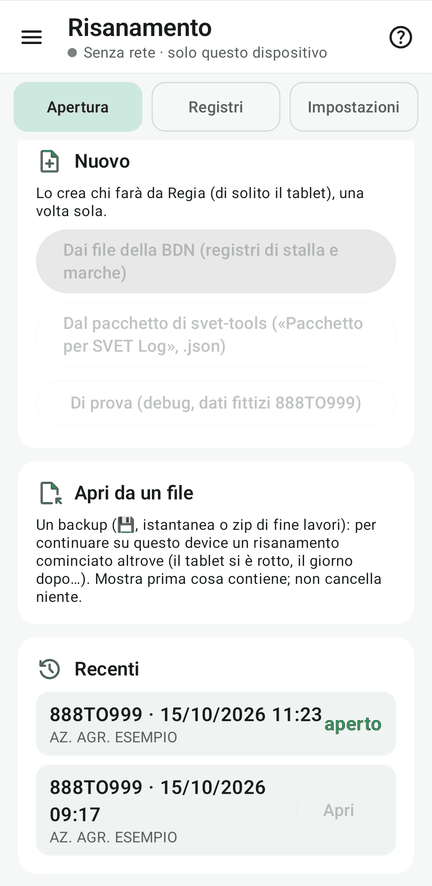

# 13 · Backup, uscita, ripresa

**Obiettivo**: salvare il progetto, uscire e riprendere, anche su un altro device.

**Ti serve**: il tablet della Regia, un palmare; facoltativo un secondo tablet o telefono che farà da Regia nuova.

## Fai

1. **Salva** (💾, sulla Regia): lo zip del backup va in Documenti/Fejalog e all'app del cloud scelta in
   Impostazioni. In Import/Export, «Salva un backup in una cartella…» lo mette dove vuoi.
2. **Esci dall'app** (menu ☰ › Esci, in fondo) su un palmare: backup, verifica dell'allineamento, pausa; riaprendo
   l'app si riprende da lì e la rete si ricollega da sola.
3. **La Regia si rompe**: sul device nuovo, Progetto › **Apri da un file** › il backup. Leggi l'anteprima e
   **subentra come Regia**; poi Rete › «Apri la rete». Se ci sono backup parziali su più telefoni, Fejalog può unire i backup superstiti recuperando tutti gli eventi.
4. **Chiudi** (Progetto › Chiudi, o Rete › Esci sul palmare): backup, uscita ordinata, il progetto resta fra i
   **Recenti**. La Regia chiude per ultima.

<figure markdown="span">
  
  <figcaption>Esci: backup, poi l'app si chiude</figcaption>
</figure>

<figure markdown="span">
  
  <figcaption>Apri da un file e i Recenti</figcaption>
</figure>

!!! atteso "Cosa devi vedere"
    - Il backup si chiama **fejalog_backup_888TO999_‹data-ora›_‹codice fiscale›_R.zip** (R per la Regia, o per chi
      lavora da solo; P per un palmare).
    - Il ripristino **non cancella niente**: aggiunge gli eventi che mancano, e si può ripetere.
    - Dopo il subentro i device di prima escono; i loro numeri restano loro e, se sono accesi, rientrano appena
      lavorano.

## Fatto?

- [ ] backup salvato
- [ ] uscita e ripresa
- [ ] subentro come Regia (facoltativo)
