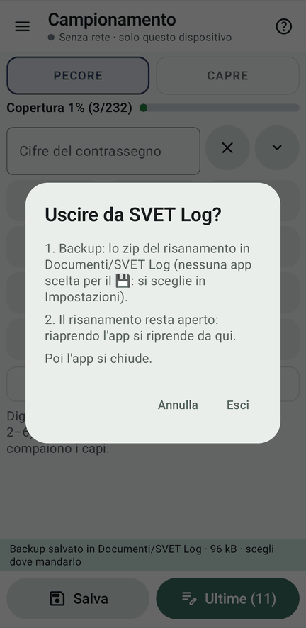
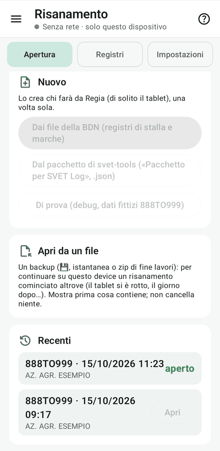

# 13 · Backup, uscita, ripresa

**Obiettivo**: salvare il progetto, uscire e riprendere, anche su un altro device.

**Ti serve**: il tablet della Regia, un palmare; facoltativo un secondo tablet o telefono che farà da Regia nuova.

## Fai

1. **Salva** (💾, sulla Regia): lo zip del backup va nella cartella locale configurata in **Impostazioni › Cartelle** (con ripiego su Documenti/Fejalog) e nella cartella remota/cloud tramite la coda delle copie pendenti. Le cartelle si scelgono una volta sola e all'uscita non serve selezionarle nuovamente.
2. **Esci dall'app** (menu ☰ › **Esci dall'app**, in fondo) su ciascun device: salvataggio dell'istantanea locale finale (con attesa fino a 5 secondi), verifica dell'allineamento e pausa; riaprendo l'app si riprende da dove si era rimasti e la rete si ricollega automaticamente.
3. **La Regia si rompe**: sul device nuovo, **Progetto › Apri progetto** › il backup. Leggi l'anteprima e
   **subentra come Regia**; poi apri **Configurazione › 4. Rete del progetto**. Se ci sono backup parziali su più telefoni, Fejalog può riconciliare i backup superstiti (**Progetto › Riconcilia backup**) recuperando tutti gli eventi.
4. **Chiudi il progetto** (menu ☰ › **Esci dal progetto**): backup, uscita ordinata dalla rete, il progetto resta fra i
   **Recenti**. La Regia chiude per ultima.

<figure markdown="span">
  
  <figcaption>Esci: backup, poi l'app si chiude</figcaption>
</figure>

<figure markdown="span">
  
  <figcaption>Apri da un file e i Recenti</figcaption>
</figure>

!!! atteso "Cosa devi vedere"
    - Il backup si chiama **fejalog_backup_888TO999_‹data-ora›_‹codice fiscale›_R.zip** (R per la Regia, o per chi
      lavora da solo; P per un palmare).
    - Il ripristino **non cancella niente**: aggiunge gli eventi che mancano, e si può ripetere.
    - Dopo il subentro i device di prima escono; i loro numeri restano loro e, se sono accesi, rientrano appena
      lavorano.

## Fatto?

- [ ] backup salvato
- [ ] uscita e ripresa
- [ ] subentro come Regia (facoltativo)
