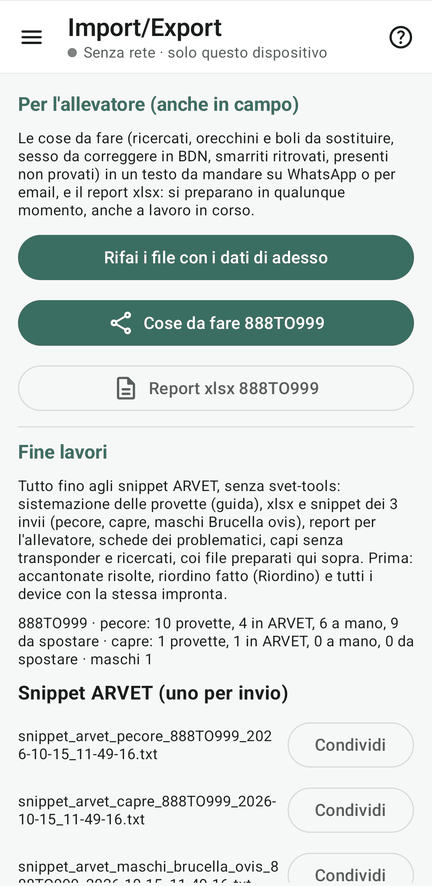
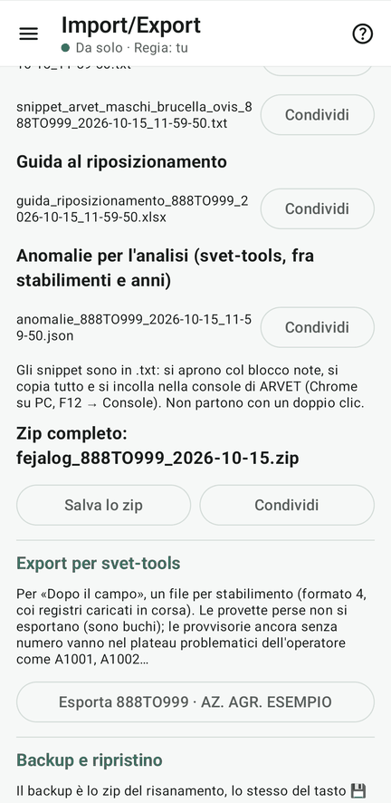

# 14 · Fine lavori

**Obiettivo**: preparare tutto quello che serve dopo il campo: snippet ARVET, cose da fare per l'allevatore, report.

**Ti serve**: il tablet della Regia, col riordino fatto e tutti i device allineati (stessa impronta) o usciti.

## Fai

1. Menu ☰ › **Import/Export** › **«Prepara i file (allevatore e fine lavori)»**.
2. Leggi le **cose da fare per l'allevatore**: un testo da mandare su WhatsApp o per email.
3. In fondo, **«Zip completo»**: «Salva lo zip» o «Condividi».

<figure markdown="span">
  
  <figcaption>Cose da fare, report e il riassunto per specie</figcaption>
</figure>

<figure markdown="span">
  
  <figcaption>Snippet, guida, anomalie e lo zip completo</figcaption>
</figure>

!!! atteso "Cosa devi vedere"
    - Nelle **cose da fare per l'allevatore**:
        - i ricercati trovati;
        - gli orecchini e i boli da sostituire (le caselle DX, SX e bolo della [lezione 6](06-prelievo.md));
        - gli smarriti ritrovati;
        - gli ingressi da registrare in BDN per l'acquisto con DDA (888TO777);
        - i presenti in BDN non provati.
    - Nello **zip**:
        - gli snippet ARVET dei tre invii (`snippet_arvet_….html` e un `.txt` per invio);
        - gli xlsx per ARVET;
        - la guida al riposizionamento e le schede dei problematici;
        - il report per l'allevatore;
        - i capi senza transponder e i ricercati;
        - le anomalie;
        - l'export per svet-tools e il registro completo.
    - Nella pagina degli snippet, per ogni invio quante provette ci sono e quante **non sono nell'elenco di ARVET**: lo
      snippet le aggiunge con «Inserisci capo». A mano restano solo i doppi di contrassegno.

!!! info "In alternativa: svet-tools"
    Lo zip del backup si carica così com'è in svet-tools, «Ciclo completo: BDN → campo → ARVET» › «Dopo il campo»:
    stessa sistemazione, stessi snippet.

## Fatto?

- [ ] cose da fare per l'allevatore lette
- [ ] zip di fine lavori salvato
