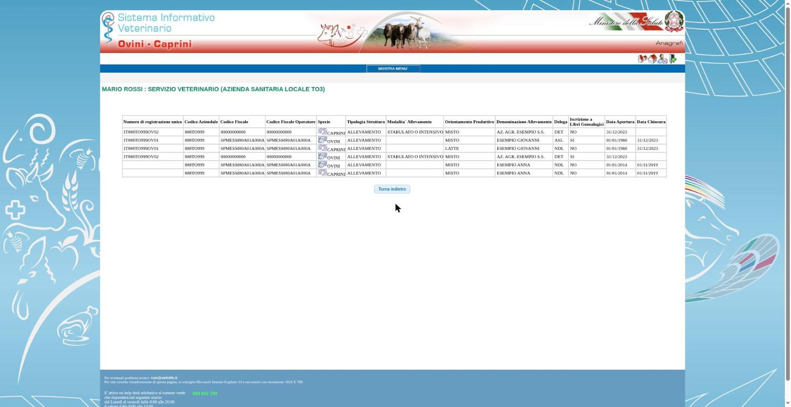
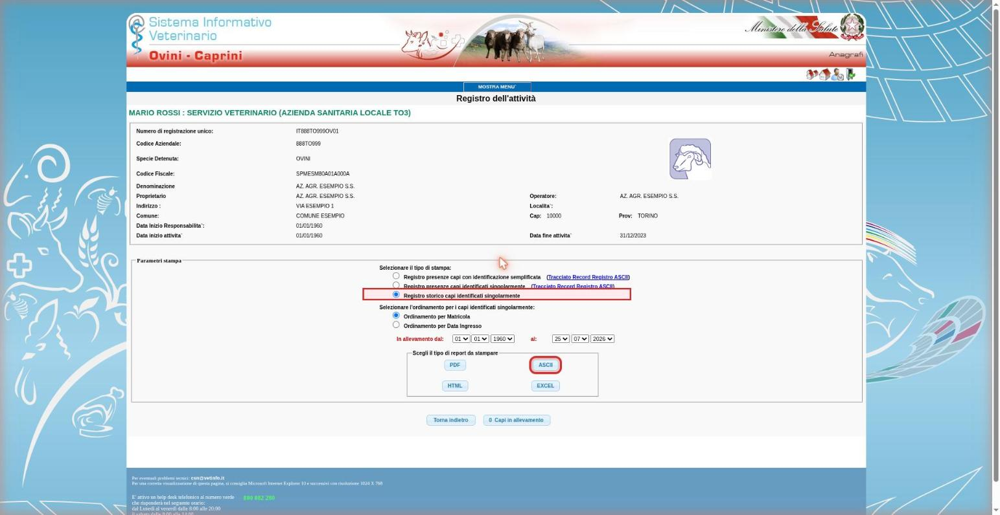
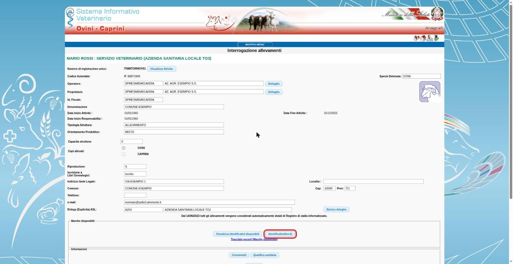

# Reperire i file BDN

**Obiettivo:** preparare registri storici e contrassegni da caricare in **Dati › Registri BDN e contrassegni**.

Le schermate seguenti provengono dal manuale locale di svet-tools e contengono dati di esempio. Le voci possono variare con la versione della BDN.

## 1. Trova gli allevamenti dello stabilimento

Accedi a Vetinfo, sezione Ovini-Caprini con il ruolo del Servizio veterinario. Apri **Dati › Interrogazioni › Allevamenti** e cerca il codice dello stabilimento.

Considera ogni allevamento pertinente, distinto per specie e operatore. I registri degli altri stabilimenti utili al riconoscimento dei capi si possono caricare separatamente.

## 2. Scarica il registro storico in ASCII

Dalla stampa del registro scegli **Registro storico capi identificati singolarmente**. Imposta l'intervallo dall'inizio dell'attività alla data attuale, oppure alla fine dell'attività per un allevamento cessato. Seleziona **ASCII**.

Il registro storico consente di riconoscere anche i capi usciti. Non sostituirlo con una stampa delle sole presenze o con un PDF.

## 3. Scarica i contrassegni disponibili

Nella scheda dell'allevamento trova il riquadro **Marche disponibili** e premi **Identificativi(Ascii)**.

Ripeti per le specie pertinenti. Se il file non indica la specie, Fejalog te la chiede prima di utilizzarlo.

## 4. Carica i file nel progetto

Sulla Regia apri **Dati › Registri BDN e contrassegni** e scegli i file, anche in uno zip. Controlla l'anteprima prima di applicarli. Conserva gli originali nella cartella del progetto.

Puoi sostituire i file durante il lavoro: il caricamento è esplicito, conserva la storia e non cambia le etichette già scritte sulle provette.

[Continua con il progetto di prova](02-progetto.md).
