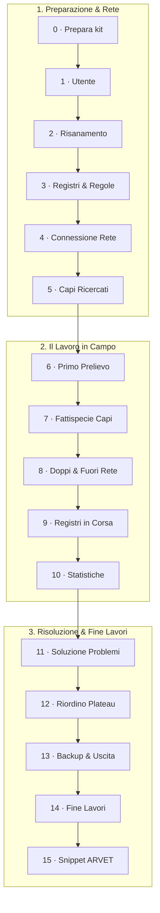

# Tutorial col kit di prova

Si impara facendo: un risanamento intero su un **gregge inventato**, dal primo device fino ad ARVET. Lo stabilimento
è 888TO999 «AZ. AGR. ESEMPIO», con 275 capi presenti (233 pecore e 42 capre). Ci sono anche gli usciti per tutti i
codici della BDN, un pascolo condiviso, le marche disponibili, i ricercati, i doppi e un venditore con DDA. Ogni capo
ha una **scheda stampata**, col barcode del codice elettronico e le ultime cifre del contrassegno.

Ogni lezione ha lo stesso schema:

- **Obiettivo** e **ti serve**;
- **fai**: i passi, in ordine;
- **cosa devi vedere**: il risultato atteso (se è diverso, è un errore da segnalare);
- **se non va**;
- **fatto?**: la lista di controllo prima di passare alla lezione dopo.

| Lezione | Chi | Durata |
|---|---|---|
| [0 · Prepara](00-prepara.md) | tutti | 20 min |
| [1 · Chi usa il device](01-utente.md) | tutti | 2 min |
| [2 · Il risanamento](02-risanamento.md) | Regia | 5 min |
| [3 · Registri e regole](03-registri-regole.md) | Regia | 5 min |
| [4 · La rete](04-rete.md) | tutti | 10 min |
| [5 · I ricercati](05-ricercati.md) | Regia | 2 min |
| [6 · Il primo prelievo](06-prelievo.md) | palmari | 15 min |
| [7 · Le fattispecie](07-fattispecie.md) | palmari | 20 min |
| [8 · Doppi e rete difficile](08-doppi-rete.md) | tutti | 15 min |
| [9 · Registri in corsa](09-registri-in-corsa.md) | Regia | 5 min |
| [10 · Statistiche e provette perse](10-statistiche.md) | tutti | 5 min |
| [11 · Soluzione problemi](11-problemi.md) | Regia | 10 min |
| [12 · Riordino dei plateau](12-riordino.md) | Regia | 15 min |
| [13 · Backup, uscita, ripresa](13-backup.md) | tutti | 10 min |
| [14 · Fine lavori](14-fine-lavori.md) | Regia | 5 min |
| [15 · ARVET](15-arvet.md) | PC | 10 min |

!!! tip "Da soli o in tanti"
    Il tutorial si può fare con un solo device (la Regia lavora da sola). Con un tablet e due o tre telefoni però si
    provano anche la rete, i doppi e la Regia che si spegne. Prelevare tutto il gregge, diviso fra più palmari, è la
    prova più vicina a un risanamento vero.
