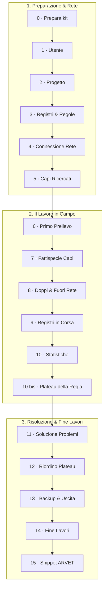

# Tutorial col kit di prova (il percorso lungo)

> **A chi serve**: a chi vuole imparare ogni singolo aspetto del funzionamento di Fejalog passo per passo, affrontando in dettaglio ciascuna schermata e operazione sul gregge fittizio di prova.  
> **Tempo di lettura**: 5 minuti (panoramica) · indice delle lezioni pratiche.

Il tutorial è un percorso formativo organico basato sul principio dell'apprendimento pratico (*learning by doing*): un intero progetto di profilassi condotto sul **gregge fittizio di prova `888TO999`** («AZ. AGR. ESEMPIO»), dal primo accesso alla Regia fino all'estrazione degli snippet per ARVET.

Tutto il gregge è inventato: 275 capi presenti (233 pecore e 42 capre), capi usciti per le causali alfabetiche BDN elencate nel kit, pascolo condiviso, marche disponibili, capi ricercati e un venditore esterno per la prova del documento di accompagnamento (DDA).

!!! info "Percorso dedicato alle anomalie"
    Parti dal [quadro completo dei casi](../anomalie.md), scegli le schede nella [tabella del kit](../kit.md#quali-anomalie-provare), poi esegui la [lezione 7](07-fattispecie.md) e verifica le soluzioni nella [lezione 11](11-problemi.md). Fuori età e stabilimenti chiusi si provano col kit a cinque stabilimenti; doppi, registri nuovi e provette perse nelle lezioni 8–10. La sola esercitazione di 60 minuti non copre tutte le fattispecie.

---

## Quali capitoli servono a ciascuna modalità

Il tutorial approfondisce le [tre modalità di simulazione](../provalo/tre-modalita.md). Le lezioni descrivono l’app Android: nel Modo A segui i nomi e i pulsanti del percorso browser. Per la prova fittizia i file BDN sono già nel kit; non scaricare dati di stabilimenti veri.

| Capitolo del tutorial | Modo A (Browser) | Modo B (Telefoni veri) | Modo C (Emulatori) |
|---|:---:|:---:|:---:|
| [0 · Prepara il kit](00-prepara.md) | — | **Necessario** | **Necessario** |
| [Reperire i file BDN](file-bdn.md) | Opzionale | Opzionale | Opzionale |
| [1 · Chi usa il device](01-utente.md) | — | **Necessario** | **Necessario** |
| [2 · Il progetto](02-progetto.md) | — | **Necessario** | **Necessario** |
| [3 · Registri e regole](03-registri-regole.md) | — | **Necessario** | **Necessario** |
| [4 · La rete locale](04-rete.md) | — | **Necessario** | **Necessario** |
| [5 · I ricercati](05-ricercati.md) | — | **Necessario** | Opzionale |
| [6 · Il primo prelievo](06-prelievo.md) | — | **Necessario** | **Necessario** |
| [7 · Le fattispecie di capi](07-fattispecie.md) | — | **Necessario** | **Necessario** |
| [8 · Doppi e rete difficile](08-doppi-rete.md) | — | **Necessario** | **Necessario** |
| [9 · Registri in corsa](09-registri-in-corsa.md) | — | **Necessario** | Opzionale |
| [10 · Statistiche e provette perse](10-statistiche.md) | — | **Necessario** | Opzionale |
| [10 bis · Il Plateau della Regia](10b-plateau.md) | **Consigliato** | **Necessario** | **Necessario** |
| [11 · Soluzione problemi](11-problemi.md) | **Consigliato** | **Necessario** | **Necessario** |
| [12 · Riordino dei plateau](12-riordino.md) | **Consigliato** | **Necessario** | **Necessario** |
| [13 · Backup, uscita, ripresa](13-backup.md) | — | **Necessario** | **Necessario** |
| [14 · Fine lavori sul computer](14-fine-lavori.md) | **Necessario** | **Necessario** | **Necessario** |
| [15 · ARVET in prova](15-arvet.md) | **Consigliato** | **Necessario** | **Consigliato** |

---

## Struttura delle lezioni

Ogni lezione del tutorial è strutturata con una griglia uniforme:

- **Obiettivo e occorrente**: cosa si impara e cosa serve avere a portata di mano;
- **Cosa fare**: la sequenza numerata delle azioni pratiche;
- **Cosa devi vedere**: il comportamento atteso a schermo (se l'app mostra un esito differente, si tratta di un'anomalia da segnalare);
- **Se qualcosa non va**: suggerimenti mirati per risolvere i dubbi più frequenti;
- **Lista di controllo finale**: caselle di verifica prima di passare alla lezione successiva.

---

## Indice delle lezioni

| Lezione | Chi se ne occupa | Durata indicativa |
|---|---|---|
| [0 · Prepara il kit](00-prepara.md) | Tutti i partecipanti | 20 min |
| [1 · Chi usa il device](01-utente.md) | Tutti i partecipanti | 2 min |
| [2 · Il progetto](02-progetto.md) | Responsabile della Regia | 5 min |
| [3 · Registri e regole](03-registri-regole.md) | Responsabile della Regia | 5 min |
| [4 · La rete](04-rete.md) | Tutti i partecipanti | 10 min |
| [5 · I ricercati](05-ricercati.md) | Responsabile della Regia | 2 min |
| [6 · Il primo prelievo](06-prelievo.md) | Veterinari con palmare | 15 min |
| [7 · Le fattispecie](07-fattispecie.md) | Veterinari con palmare | 20 min |
| [8 · Doppi e rete difficile](08-doppi-rete.md) | Tutti i partecipanti | 15 min |
| [9 · Registri in corsa](09-registri-in-corsa.md) | Responsabile della Regia | 5 min |
| [10 · Statistiche e provette perse](10-statistiche.md) | Tutti i partecipanti | 5 min |
| [10 bis · Il Plateau della Regia](10b-plateau.md) | Responsabile della Regia | 10 min |
| [11 · Soluzione problemi](11-problemi.md) | Responsabile della Regia | 10 min |
| [12 · Riordino dei plateau](12-riordino.md) | Responsabile della Regia | 15 min |
| [13 · Backup, uscita, ripresa](13-backup.md) | Tutti i partecipanti | 10 min |
| [14 · Fine lavori sul computer](14-fine-lavori.md) | Responsabile della Regia | 5 min |
| [15 · ARVET in sicurezza](15-arvet.md) | Veterinario al PC | 10 min |

!!! tip "Da soli o in squadra"
    Il tutorial può essere svolto anche da una sola persona (usando un tablet come Regia autonoma o provando il Modo A nel browser). Con un tablet e due telefoni collegati al router Wi-Fi portatile si sperimenta tuttavia la reale forza di Fejalog: la sincronizzazione multi-device distribuita e il controllo automatico dei doppi campioni.
